# 模板图鉴

118 张卡，按用途分 7 类。点缩略图进入模板目录，里面的 `<模板名>.ograf.json` 就是要导入达芬奇的文件。想先看动起来的样子，见 [README 的动图](README.md#动起来看看)。

**目录：** [标题与版式](#titles) 11 · [文字动效](#type-moves) 22 · [数据与图表](#data) 14 · [列表与步骤](#lists) 4 · [界面与交互](#ui) 24 · [卡片与场景](#cards-scenes) 28 · [转场与光效](#transitions) 15

每张卡下面一行是：默认时长 · 检查器里能改的字段数。带「可换图」的卡有图片或标志字段，带「叠加层」的卡不画背景，要放在素材上面一轨用。

## 标题与版式 · 11 张

开场标题、套印字标、文字里嵌画面、标题降级成标签这类版式卡。

<table>
<tr>
<td id="aurora-bloom-bg-flip" width="33%" valign="top">
 
<b>极光翻底转折</b> 
<code>aurora-bloom-bg-flip</code> 
浅灰底上，一团紫橙柔光从底部升起；随后整个底色在约 0.35 秒里压暗到近黑，柔光收成余晖。 
5.5 秒 · 11 个字段
</td>
<td id="blur-slide" width="33%" valign="top">
 
<b>逐词浮现标题</b> 
<code>blur-slide</code> 
暖白纸面上的编辑排版标题：刊头下的发丝线先画出，栏目眉题和两行大衬线标题逐字／逐词从虚焦里浮出，强调词（可填多个）最后落定，副标题错峰跟进，页脚发丝线收尾。 
4.0 秒 · 14 个字段
</td>
<td id="brand-ink-open" width="33%" valign="top">
 
<b>墨线压印立名</b> 
<code>brand-ink-open</code> 
品牌开场第一拍：琥珀色十字准星先在纸面上描画又淡去，字标逐字压印落定（由大到小、由虚到实，字底闪过一道强调色短划），下面等宽字体的副标用打字机逐字打出、光标闪到第 95 帧停。 
3.5 秒 · 9 个字段
</td>
</tr>
<tr>
<td id="logo-shrink-wordmark-lockup" width="33%" valign="top">
 
<b>大环收束定版</b> 
<code>logo-shrink-wordmark-lockup</code> 
霓虹缺口大环旋转收束成中央标志，带冲击波和缩放残影，字标逐字滑入、标语整行淡入，完成标志定版。 
5.0 秒 · 11 个字段 · 可换图
</td>
<td id="marker-underline-title" width="33%" valign="top">
 
<b>马克笔下划线标题</b> 
<code>marker-underline-title</code> 
两行大标题错峰落定，关键词下面一笔马克笔线从左往右画出来，片段结尾上飘淡出。 
4.0 秒 · 10 个字段 · 可换图
</td>
<td id="orbit-ring-title-open" width="33%" valign="top">
 
<b>环卡托题开场</b> 
<code>orbit-ring-title-open</code> 
石墨夜场里一圈 16:9 图片卡沿椭圆匀速公转，环从 0.62 撑开、逐卡淡入、轨道发丝线描出；远处压暗微虚、近处全亮，标题逐字解糊下沉，落定后荧光块自左横扫、扫过处字反白，mono 副行随后浮出。 
5.0 秒 · 12 个字段 · 可换图
</td>
</tr>
<tr>
<td id="paper-title-card" width="33%" valign="top">
 
<b>纸面压印标题</b> 
<code>paper-title-card</code> 
一句标题在暖白纸面上逐字压印出来（由大到小、由虚到实），强调词换成强调色，下面可以加一行带滚动数字的小字；片段结尾上飘淡出。 
4.0 秒 · 12 个字段
</td>
<td id="riso-print-hits" width="33%" valign="top">
 
<b>套印错位标题</b> 
<code>riso-print-hits</code> 
再生纸上，黑体标题从画外撞进来，命中瞬间裂成粉、蓝两版反向错位，抖两下后在第 72 帧硬切回套准，右下角同时盖下「套准」圆章；背后是一轮半调网点大太阳，底部三栏短卖点。 
4.0 秒 · 13 个字段
</td>
<td id="text-as-mask" width="33%" valign="top">
 
<b>字里有画</b> 
<code>text-as-mask</code> 
一个超大汉字（或英文词）镂空，字里透出缓慢漂移的画面，结尾画面顺着笔画冲满全屏。 
5.5 秒 · 11 个字段 · 可换图
</td>
</tr>
<tr>
<td id="title-demote-to-label" width="33%" valign="top">
 
<b>标题降为栏目标签</b> 
<code>title-demote-to-label</code> 
暖白纸面上，大标题从线后升起、站稳，然后飞向左上角缩成栏目标签，导语和 1–6 张文字卡片在下面错峰长出来，最后停住。 
4.0 秒 · 12 个字段
</td>
<td id="white-flash-logo-simplify-cut" width="33%" valign="top">
 
<b>闪白转扁平定版</b> 
<code>white-flash-logo-simplify-cut</code> 
暗场上液态字标流光蓄力，从字心炸出一记白闪，曝光回落时同一位置已是纸面上的扁平字标，随后标志揭开、标语逐词升起。 
4.5 秒 · 9 个字段 · 可换图
</td>
</tr>
</table>

## 文字动效 · 22 张

逐词浮现、打字机、装配、压入、卡拉 OK 填色，文字本身的入场与节奏。

<table>
<tr>
<td id="assemble-then-type-flyin" width="33%" valign="top">
 
<b>骨架拼装落字</b> 
<code>assemble-then-type-flyin</code> 
石墨暗场里，页面的空壳先过冲飞入拼好，停半拍后每个字带着 3D 翻滚从远处逐字落位；落定后按钮通电成金色实底、右侧媒体图亮起一档，整页还在极缓推近。 
5.5 秒 · 15 个字段 · 可换图
</td>
<td id="brace-expand" width="33%" valign="top">
 
<b>花括号拉幕</b> 
<code>brace-expand</code> 
一对电光蓝花括号先紧贴着出现，再带一次弹簧过冲向左右弹开，把中间的标题像幕布一样拉出来；落定后字距松弛、括号泛光回落，眉题和副标随后入场，最后整幅极缓前推。 
4.0 秒 · 11 个字段
</td>
<td id="flying-words" width="33%" valign="top">
 
<b>词语纵深隧道</b> 
<code>flying-words</code> 
一排关键词从隧道深处沿纵深飞向镜头、擦身而过，循环不停；正中压一组静态标题（眉题 + 主标题），也可以关掉标题当纯背景用。 
6.0 秒 · 13 个字段 · 可换图
</td>
</tr>
<tr>
<td id="gradient-word-sweep" width="33%" valign="top">
 
<b>渐变扫光大字</b> 
<code>gradient-word-sweep</code> 
一个发光的大字被一道彩色渐变从左到右扫亮：先扫出蓝青、紫、粉、琥珀四段色，再叠三层柔光、波前尾迹和过曝亮核，扫完后在字上零星跳出紫色闪电，最后停在发光的字上；下面可以有一行标语，两行错峰浮入。 
3.5 秒 · 10 个字段
</td>
<td id="lead-word-zoom-assemble" width="33%" valign="top">
 
<b>首词放大成句</b> 
<code>lead-word-zoom-assemble</code> 
首词先以大字号占住画面正中，短暂停留时继续向观众推近，然后缩回终字号、整行左滑落位；后半句的词从右侧逐个推入，整行上移时副行浮出，之后画面停住，片段结尾统一上飘淡出。 
3.0 秒 · 11 个字段
</td>
<td id="letterspace-materialize" width="33%" valign="top">
 
<b>字距结晶显影</b> 
<code>letterspace-materialize</code> 
暮色湖面上，一行大字距的细线字标整词同步显影：所有字符同帧起笔、描边随进度从左到右扫开、同帧齐收，画完瞬间轻轻提亮再回落，水面里有它的倒影。 
3.5 秒 · 8 个字段
</td>
</tr>
<tr>
<td id="neon-triple-marquee" width="33%" valign="top">
 
<b>三行对滚轮唱</b> 
<code>neon-triple-marquee</code> 
一面斜拍的夜墙，三行灯管词左右反向对滚，一行一行轮着点亮，像霓虹招牌在轮唱；亮行的光溢到砖墙和湿地上，最后自上而下断电，停在熄灯海报上再统一出场。 
5.5 秒 · 9 个字段
</td>
<td id="outline-word-fill" width="33%" valign="top">
 
<b>空心字点亮</b> 
<code>outline-word-fill</code> 
一个空心大字从 3.2 倍急缩落位，背后的虚线大圆从画外收拢，两侧虚线向内瞄准，「以前 / 现在」的读数随后出现；描边预热后第 54 帧一帧硬切成白热实心，闪一下辉光和冲击环再定格。 
3.0 秒 · 16 个字段 · 可换图
</td>
<td id="slam-entrance-moves-impact" width="33%" valign="top">
 
<b>重卡砸槽震邻</b> 
<code>slam-entrance-moves-impact</code> 
一张成片规格页：左右两张纸白规格卡驻场，中间留一个虚线空槽；深墨蓝的主角卡从镜头上方放大、虚焦地悬着，六帧砸进空槽。 
4.5 秒 · 12 个字段
</td>
</tr>
<tr>
<td id="slam-entrance-moves-kanada" width="33%" valign="top">
 
<b>透视甩入急停</b> 
<code>slam-entrance-moves-kanada</code> 
一张发布片首映卡从左侧以金田式鱼眼透视甩进画面，落定瞬间弹平、震屏、炸开一圈集中线：左半是你的海报图，右半是角签、片名、副标、规格和播放按钮，卡外一行字幕逐字升起。 
4.0 秒 · 15 个字段 · 可换图
</td>
<td id="stroke-segment-build" width="33%" valign="top">
 
<b>断笔成字</b> 
<code>stroke-segment-build</code> 
深紫墙上的一块霓虹灯牌：标题被切成一条条横向碎片，跨字乱序点亮，前七成读不出字，停一拍后三条底段落下，整词在一瞬间成立，墙面和地面跟着亮起，灯牌在下方留下倒影。 
5.5 秒 · 7 个字段
</td>
<td id="text-column-converge" width="33%" valign="top">
<a href="templates/type-moves/text-column-converge">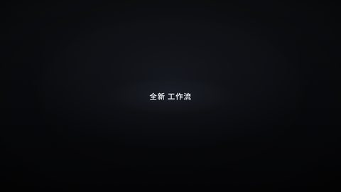</a> 
<b>左右词合拢</b> 
<code>text-column-converge</code> 
左边一个词钉在左侧、右边一个词钉在右侧，右边的词逐个轮换（最多 12 个）；最后一个词停稳后两边合拢成居中的一句，下方再浮出一行小字。 
4.5 秒 · 10 个字段
</td>
</tr>
<tr>
<td id="type-assembly-moves-drift-assembly" width="33%" valign="top">
 
<b>漂移合拢片名</b> 
<code>type-assembly-moves-drift-assembly</code> 
一行大字，每个字从自己那条固定方向带着模糊、旋转和纵深漂回来，落定瞬间加深闪一下；全部落定后整词轻轻呼吸一次，字面下方浮出一层落地影。 
5.0 秒 · 8 个字段
</td>
<td id="type-assembly-moves-split-stagger" width="33%" valign="top">
 
<b>逐字裂升标题</b> 
<code>type-assembly-moves-split-stagger</code> 
一行大字，每个字从自己的裁切盒底升起、微微冲过再落回，逐字错峰；字下一条强调色基线同时从左生长。 
4.5 秒 · 8 个字段
</td>
<td id="type-assembly-moves-text-on-path" width="33%" valign="top">
 
<b>沿增长线流入</b> 
<code>type-assembly-moves-text-on-path</code> 
整句标题沿着一条从左下爬到右上的发光增长曲线推进，每个字按切线角旋转，到顶后逐字抬升摆正成左上标题；曲线车头光点、季度标记和数值牌随后点亮。 
5.5 秒 · 15 个字段
</td>
</tr>
<tr>
<td id="type-entrance-moves" width="33%" valign="top">
 
<b>字符坠落</b> 
<code>type-entrance-moves</code> 
一行大字从上方依次坠落，落地弹两下、压一下，歪着小角度站定，每个字脚下有一抹接触影；第 110 帧整行吸气回正，副标题随后浮出。 
5.0 秒 · 8 个字段
</td>
<td id="type-rhythm-sync-font-weight-pump" width="33%" valign="top">
 
<b>字重打拍</b> 
<code>type-rhythm-sync-font-weight-pump</code> 
一句短标题踩在两小节的固定节拍上：静止时字是细的、字与字之间留着缝，每一拍笔画由细变粗再弹回，第二小节长出上下两行描边回声，第九拍落成粗体渐变海报；右上角是真实 BPM，底部 8+1 格音序器跟着亮。 
5.5 秒 · 12 个字段
</td>
<td id="type-rhythm-sync-karaoke-fill-sync" width="33%" valign="top">
 
<b>逐词填色跟读</b> 
<code>type-rhythm-sync-karaoke-fill-sync</code> 
旁白读到哪个词，哪个词就从左到右柔边填亮，读指下划线跟着前沿，读完退成主墨色；底部 48 根旁白波形跟着起伏。 
5.0 秒 · 9 个字段
</td>
</tr>
<tr>
<td id="typewriter-moves" width="33%" valign="top">
 
<b>打字机改口</b> 
<code>typewriter-moves</code> 
一句话先被慢慢打出来，光标犹豫两下后把后半句逐字退格删掉，再用更快的节奏重打一遍，最后一道马克笔底色从左到右铺在指定的词下面。 
4.0 秒 · 13 个字段
</td>
<td id="vertical-word-roll-blur-cycle" width="33%" valign="top">
 
<b>句尾滚轮换词</b> 
<code>vertical-word-roll-blur-cycle</code> 
句干不动，句尾三行高的视窗里一串词往上滚：中心词清晰、落定瞬间从灰染成强调色，相邻行纵向模糊、按滚筒曲面压扁，视窗上下沿柔边渐隐。 
5.0 秒 · 9 个字段
</td>
<td id="word-relay-filmstrip" width="33%" valign="top">
 
<b>证据胶片换词</b> 
<code>word-relay-filmstrip</code> 
左列证据页像胶片一格一格上滚，右侧名词不动、动词原位接力：旧词灰化升出，新词逐字从遮罩下沿升起，金色句点最后落定，注脚和金色引线同步换到下一页。 
6.0 秒 · 12 个字段 · 可换图
</td>
</tr>
<tr>
<td id="word-relay-geometry" width="33%" valign="top">
 
<b>一词一几何</b> 
<code>word-relay-geometry</code> 
几个利益词一拍一拍接力：第一个词配虚线大圆加彗星飞弧，中间的词配三个依次长满再咬紧的圆，最后一个词金属扫光后收成纯白，下面一行副句逐词升起来。 
6.5 秒 · 9 个字段
</td>
</tr>
</table>

## 数据与图表 · 14 张

仪表、折线、点阵数字、时间线和信息图。

<table>
<tr>
<td id="bezier-source-converge-merge" width="33%" valign="top">
 
<b>多路汇一点</b> 
<code>bezier-source-converge-merge</code> 
左侧几枚白瓷圆片节点，各由一条细贝塞尔曲线汇向右侧同一点：曲线先从左往右画出，强调色数据包带彗尾沿路滑行，节点随后沿自己的曲线滑进汇聚点并缩小消失，涟漪一圈接收，曲线从左端反向擦除，结尾徽标收到画面正中、下方字幕逐词加深。 
5.5 秒 · 10 个字段 · 可换图
</td>
<td id="chart-live-moves-axis-rescale" width="33%" valign="top">
 
<b>爆表重标折线</b> 
<code>chart-live-moves-axis-rescale</code> 
一页米色瑞士网格数据海报：左上标题逐字升起，右上年度合计 KPI，满版折线一路爬升到最后一个爆表点，冲出天花板、撞进 KPI，停半拍后 y 轴整体重标（旧刻度飞出、新刻度滑入、网格加密、旧折线压扁成地平线），新值落回并弹出赤陶数值标签。 
6.0 秒 · 15 个字段
</td>
<td id="chart-live-moves-dot-swarm" width="33%" valign="top">
 
<b>点阵聚成数字</b> 
<code>chart-live-moves-dot-swarm</code> 
320 个点先散布漂浮，再按组聚成簇、码成柱，最后聚到终幕大数字后面形成光晕底。 
6.5 秒 · 13 个字段
</td>
</tr>
<tr>
<td id="chart-live-moves-oscilloscope" width="33%" valign="top">
 
<b>示波实时曲线</b> 
<code>chart-live-moves-oscilloscope</code> 
满版示波器屏：电光蓝磷光迹线向左流动，写入头经过时一记 2.2 倍的珊瑚红尖峰打进来，「突发」标签钉上峰顶随流漂走，随后流速刹停、镜头缓推向尖峰。 
5.5 秒 · 17 个字段
</td>
<td id="countdown-arc-scatter" width="33%" valign="top">
 
<b>表盘扫数落标题</b> 
<code>countdown-arc-scatter</code> 
一只巨大的纸面表盘把一排数字扫过画面急停，停在弧顶的数字飞进标题第一个字，其余数字原地失焦散去，标题逐词浮现、强调词转强调色，下面升起一句描边胶囊小字。 
3.5 秒 · 14 个字段
</td>
<td id="dataviz-landscape-open" width="33%" valign="top">
<a href="templates/data/dataviz-landscape-open">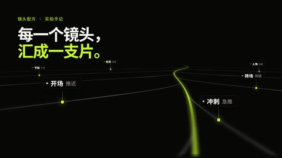</a> 
<b>流线汇流开场</b> 
<code>dataviz-landscape-open</code> 
暗场里一条荧光主干从镜头脚下奔向画面右 1/3 的消失点，支流切向汇入，镜头标签按透视立在支流上，随后两行标题在天空里逐字升起。 
6.5 秒 · 11 个字段
</td>
</tr>
<tr>
<td id="gauge-readout-moves-needle" width="33%" valign="top">
<a href="templates/data/gauge-readout-moves-needle">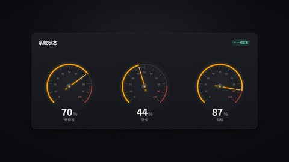</a> 
<b>三表甩针自检</b> 
<code>gauge-readout-moves-needle</code> 
一排最多四个 270° 表盘错峰点火：指针 12 帧甩满全弧（扫过的刻度依次点亮再回落），再按落过头 8° 的弹簧回摆到真实数值，落定同帧数值弹出、指标名淡入；卡头状态胶囊在自检中和完成两段文案间切换。 
5.0 秒 · 12 个字段
</td>
<td id="gauge-readout-moves-tape" width="33%" valign="top">
 
<b>滚带定针读数</b> 
<code>gauge-readout-moves-tape</code> 
一条竖向刻度带在钴蓝读数窗后滚动、指针钉死不动：读数慢爬顶到旧上限虚线，虚线断开，回拉一下后刻度带带着运动模糊冲刺，弹簧刹车冲过新上限再回摆落定，钴蓝三角恰好停进指针；左侧标题升起、结论逐字浮现、涨幅胶囊和「旧 → 新」小结收尾。 
5.0 秒 · 16 个字段
</td>
<td id="impact-feedback-hit-counter" width="33%" valign="top">
 
<b>连招砸卡计数</b> 
<code>impact-feedback-hit-counter</code> 
钴蓝街机海报：两到四张白卡接连砸进虚线槽位，每次命中整幅画面顿两帧、卡面闪白、白色冲击环炸开、黄色火花迸射、伤害数字上浮，右上角的 ×N 连击计数逐次加码，最后一行收益逐字升起。 
6.0 秒 · 12 个字段
</td>
</tr>
<tr>
<td id="integration-hub-map" width="33%" valign="top">
 
<b>翻面亮管接生态</b> 
<code>integration-hub-map</code> 
白色双面面板在近景里快翻 180°，侧棱闪一下白热，落成新页面后一圈 logo 瓷贴同帧弹现、光管同时接通，彗星脉冲持续往里输送、面板呼吸。 
5.0 秒 · 10 个字段 · 可换图
</td>
<td id="slam-entrance-moves-score" width="33%" valign="top">
 
<b>比分重拳砸落</b> 
<code>slam-entrance-moves-score</code> 
夜场终场比分卡：卡先悬在镜头前虚焦蓄力，六帧砸到屏心，落点同帧爆出金辉冲击环、玻璃与金箔碎片、火花、竖向震屏和一道白闪，比分数字随后二次落地，顶签滑出、胜方金线下划，卡下标题逐字升起。 
4.5 秒 · 19 个字段 · 可换图
</td>
<td id="timeline-travel" width="33%" valign="top">
 
<b>时间轴急停推近</b> 
<code>timeline-travel</code> 
镜头沿水平时间轴缓起、冲刺、急刹三段变速横移，每过一站卡片从刻度线上弹簧过冲弹起，末站急停并推近 1.28×。 
5.5 秒 · 9 个字段
</td>
</tr>
<tr>
<td id="value-stagger-gradient" width="33%" valign="top">
 
<b>柱阵错峰脉冲</b> 
<code>value-stagger-gradient</code> 
一排发光圆角柱从暗色地面上按左到右的顺序逐根长出来（高度、位移、模糊、颜色从第一根到最后一根铺成梯度），第二拍一道脉冲从中间向两边扫过。 
5.0 秒 · 6 个字段
</td>
<td id="voice-waveform-live" width="33%" valign="top">
 
<b>录音声纹胶囊</b> 
<code>voice-waveform-live</code> 
米色暖光里，上方一句实时转写逐词出现、由虚变实，说出的词先亮成赤陶再沉成墨色；下方胶囊里64条声纹从右往左滚动，麦克风随说话呼吸。 
6.0 秒 · 12 个字段
</td>
</tr>
</table>

## 列表与步骤 · 4 张

菜单、步骤条、表格行这类条理内容的入场。

<table>
<tr>
<td id="beat-step-list-theme-cycle" width="33%" valign="top">
 
<b>逐拍换词换色</b> 
<code>beat-step-list-theme-cycle</code> 
一个词一拍：胶囊接住新词、换色，词表向上滚一行；前导词钉在胶囊左边，口号在右下逐字升起。 
5.0 秒 · 11 个字段
</td>
<td id="list-reveal" width="33%" valign="top">
 
<b>列表逐项入场</b> 
<code>list-reveal</code> 
一列侧栏条目逐项找位，整列同时缓慢上漂；当前项是一块瓷白高亮条，未读徽章挂在指定一项上，右侧标题等列表铺到一半才逐行升起。 
4.0 秒 · 15 个字段
</td>
<td id="list-stack-press" width="33%" valign="top">
 
<b>列表摞起跳数</b> 
<code>list-stack-press</code> 
暖白纸面上，列表卡一张接一张从下方 600px 升入摞起：计数器先亮起，之后每 12 帧落一张卡，交替带 2° 倾斜，每张飞来时把已落定的整摞压下 6px 再弹回；落定后荧光笔从左长出，最后一张落定后一道斜光扫过整摞。 
3.0 秒 · 12 个字段 · 可换图
</td>
</tr>
<tr>
<td id="row-embed" width="33%" valign="top">
<a href="templates/lists/row-embed">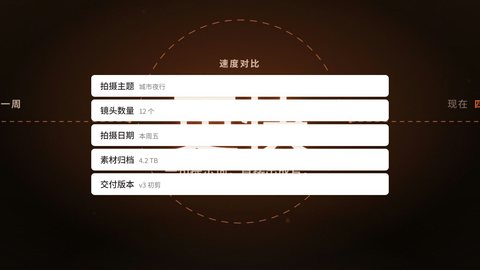</a> 
<b>内容行嵌入</b> 
<code>row-embed</code> 
一行行内容从空中落下、rotateX 收平，扣进画面中央的内容栏，落地瞬间底边亮一道强调色缝。 
3.0 秒 · 10 个字段 · 可换图
</td>
</tr>
</table>

## 界面与交互 · 24 张

光标、HUD、扫描标注、下拉、药丸、滑块，界面演示与叠加标注。

<table>
<tr>
<td id="before-after-slider-scrub" width="33%" valign="top">
<a href="templates/ui/before-after-slider-scrub">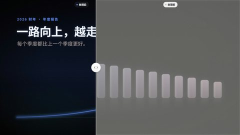</a> 
<b>前后对比拉杆</b> 
<code>before-after-slider-scrub</code> 
两张同机位的对比图（修图前后、旧版/新版界面、装修前后都行）铺满画面，竖分割杆快速甩到右侧再慢慢扫回，杆左侧露出「处理后」那张。 
5.0 秒 · 6 个字段 · 可换图
</td>
<td id="chip-grid-single-select-blackout" width="33%" valign="top">
 
<b>单选反黑揭晓</b> 
<code>chip-grid-single-select-blackout</code> 
几个选项 chip 居中排好，一只光标从右下走弧线点中其中一项：灰闪一帧、反黑成白字、带勾，其余 chip 淡没；黑块上移收窄回中线，下面升起结算——原价被划掉、现价、优惠标签。 
5.5 秒 · 16 个字段
</td>
<td id="collab-cursor-moves" width="33%" valign="top">
<a href="templates/ui/collab-cursor-moves">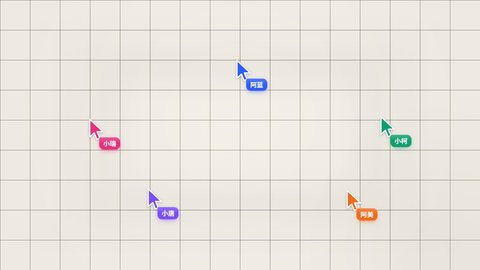</a> 
<b>协作光标游走</b> 
<code>collab-cursor-moves</code> 
一层可以直接叠在你的白板、画布或录屏上的协作光标：五个带姓名徽标的彩色光标从画面四边错峰飞入，落在中心的椭圆上轻轻漂移，第 98 帧一起聚拢到你指定的位置。 
5.0 秒 · 6 个字段 · 叠加层
</td>
</tr>
<tr>
<td id="cursor-flyover" width="33%" valign="top">
 
<b>光标巡览特写</b> 
<code>cursor-flyover</code> 
你的页面图装进一个浅色应用窗：相机从整页俯瞰依次飞到各站特写，macOS 光标先一步到位、轻弧线飞行、点击留下涟漪，站名小签在光标旁浮现，最后拉回俯瞰停住。 
6.4 秒 · 9 个字段 · 可换图
</td>
<td id="doc-park-left-pill-deal" width="33%" valign="top">
 
<b>文档驻留发结论</b> 
<code>doc-park-left-pill-deal</code> 
一页文档靠左驻留（向左滑出、微缩到0.92，全程极缓慢上滚），右侧按节拍慢发白底药丸，每张落定后逐字加深一句字幕，下一张到来前淡出。 
6.0 秒 · 9 个字段 · 可换图
</td>
<td id="document-typewriter-reveal" width="33%" valign="top">
 
<b>文档逐行写出</b> 
<code>document-typewriter-reveal</code> 
暗场里一扇悬浮的应用窗口，标题和正文在紫色笔尖后一行行自己写出来，左侧的周报条目逐条落入，最后一行标语从底部升起。 
5.0 秒 · 14 个字段
</td>
</tr>
<tr>
<td id="draw-svg-trace" width="33%" valign="top">
<a href="templates/ui/draw-svg-trace">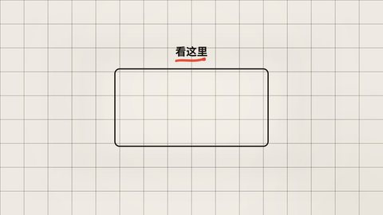</a> 
<b>手绘圈注</b> 
<code>draw-svg-trace</code> 
叠在你的画面上，用一支带笔头的墨线沿圆角矩形跑一圈，把重点圈出来；闭合时线会冲深加粗、四角裁切标记外弹退场，描边随后一直留在画面里。 
4.0 秒 · 12 个字段 · 叠加层
</td>
<td id="fui-hud-moves" width="33%" valign="top">
<a href="templates/ui/fui-hud-moves">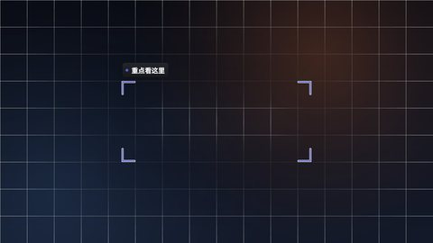</a> 
<b>取景框咬合</b> 
<code>fui-hud-moves</code> 
叠在你的画面上：四个 L 形角标带速度模糊从右下画外飞入，超调回弹后收缩贴紧目标、咬合帧角标收紧一下，中心十字随后淡出，框上方弹出带状态点的深色标签并停住。 
3.0 秒 · 10 个字段 · 叠加层
</td>
<td id="glass-pill-dictation-typing" width="33%" valign="top">
 
<b>胶囊听写打字</b> 
<code>glass-pill-dictation-typing</code> 
一条磨砂玻璃胶囊以 1.25 倍落位，胶囊里自左淡到右浓铺一层暖光；光标先行，听写句匀速打出，暖光随打字渐渐退去，最后停成一条中性磨砂玻璃条。 
3.5 秒 · 11 个字段
</td>
</tr>
<tr>
<td id="hashtag-to-pill-materialize" width="33%" valign="top">
 
<b>话题词变胶囊</b> 
<code>hashtag-to-pill-materialize</code> 
一句话话题词在近白纸面上逐字打出，光标恒亮；第 48 帧硬切实体化成一颗带 # 图标的灰色胶囊，停 0.6 秒后缩小左移，落到成品页的标签位，第 83 帧再一帧硬切揭示奶油色笔记页：墨绿标题、三行正文，胶囊换成鼠尾草绿。 
4.0 秒 · 10 个字段
</td>
<td id="icon-performance-moves" width="33%" valign="top">
 
<b>图标弹跳求关注</b> 
<code>icon-performance-moves</code> 
奶油色 Dock 里的一枚应用图标先蹲一下，再连跳四次、一次比一次高，落地压扁、荡开涟漪溅点；后几次邻居图标失焦变淡，最高那跳镜头推近，落定后角标弹出、运行点亮起，功能面板从图标旁弹簧展开。 
5.5 秒 · 12 个字段 · 可换图
</td>
<td id="picker-carousel-feature-cycle" width="33%" valign="top">
 
<b>竖向吸附轮播</b> 
<code>picker-carousel-feature-cycle</code> 
一列功能名在纸面选择器里逐项吸附、穿过不动的焦点药丸，每次落定药丸轻轻一呼吸；当前项前有一颗强调色小圆点，视口上下渐隐。 
4.0 秒 · 8 个字段
</td>
</tr>
<tr>
<td id="pill-chip-slot-cycle-handled" width="33%" valign="top">
 
<b>胶囊滚轮挤开</b> 
<code>pill-chip-slot-cycle-handled</code> 
浅底一句话「你的 镜头 我们全包了」：中间的深色胶囊里词竖向滚动，胶囊宽度随词长平滑伸缩，两侧的字被自然挤开又收回；胶囊上下露出淡淡的幽灵词，暗示还能往下滚。 
5.0 秒 · 10 个字段
</td>
<td id="pill-slot-cycle" width="33%" valign="top">
 
<b>句尾词槽轮换</b> 
<code>pill-slot-cycle</code> 
句干钉在左端，句尾的胶囊每 0.7 秒滚一格：旧的上飞、新的从下带运动模糊翻进来；换完最后一个词胶囊飞走，收束句带着一次过冲落位，整行再缓缓居中。 
6.5 秒 · 12 个字段
</td>
<td id="radial-ripple-phone-chips" width="33%" valign="top">
 
<b>波纹手机定格</b> 
<code>radial-ripple-phone-chips</code> 
四层暖沙色同心圆错相呼吸，中央手机从下方升起，屏内是用户自己的图片（不填时显示一屏内容列表的剪影，不滚动），图片比屏幕高时缓慢上滑、从状态栏和底部渐隐下面穿过；两侧胶囊先左后右弹出并悬浮，左下角标题和标语最后升起。 
5.5 秒 · 14 个字段 · 可换图
</td>
</tr>
<tr>
<td id="scan-bracket-sweep" width="33%" valign="top">
<a href="templates/ui/scan-bracket-sweep">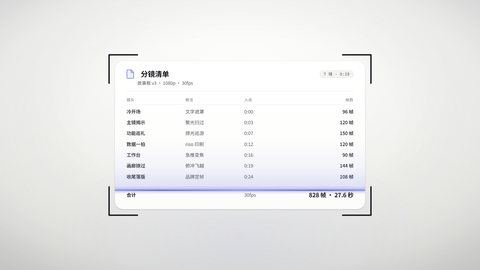</a> 
<b>取景扫描读档</b> 
<code>scan-bracket-sweep</code> 
一份白色文档弹进画面中央，四角落下取景括号，一条靛蓝扫描光带带着渐变拖尾在文档上往复扫几趟，光经过的行会被轻微照亮，扫完定格。 
5.0 秒 · 15 个字段 · 可换图
</td>
<td id="scanline-annotate-focus" width="33%" valign="top">
 
<b>扫描线逐块标注</b> 
<code>scanline-annotate-focus</code> 
一张页面图放在浏览器窗里，一条钴蓝扫描线以严格匀速自上而下掠过；线越过哪块的下缘，哪块就弹出四角取景框（弹簧一次过冲）并闪一下对焦，随后贴出一枚逐字打出的机器标签，顶部状态行实时计数。 
5.0 秒 · 11 个字段 · 可换图
</td>
<td id="scanline-assemble-flyin" width="33%" valign="top">
 
<b>扫描装配建页</b> 
<code>scanline-assemble-flyin</code> 
一张深蓝蓝图画板先亮起来，电光蓝扫描线匀速下掠；扫到哪个槽位，那一块就从画外飞入、过冲贴合，四角闪出咬合角标，虚线槽位随之消失。 
5.5 秒 · 12 个字段 · 可换图
</td>
</tr>
<tr>
<td id="scroll-brake-moves-changelog" width="33%" valign="top">
 
<b>长卷急刹停更</b> 
<code>scroll-brake-moves-changelog</code> 
一整年的更新日志从下往上高速掠过，快起步、长尾减速，急刹停在画面正中；最后一行抬升 1.03、描上强调色，其余行退暗到 0.38。 
5.0 秒 · 10 个字段
</td>
<td id="scroll-brake-moves-reticle-lock" width="33%" valign="top">
 
<b>急刹准星锁定</b> 
<code>scroll-brake-moves-reticle-lock</code> 
更新记录从下往上高速掠过，急刹冲过头 30px 再回弹落定；停住的那一帧，四个 L 形准星从画外飞入咬住「条目」的最后一行（目标行），该行亮起、其余行退暗，右侧弹出「刚刚发布」小标签；目标行下面跟着几条「后续计划」，标题偏灰，同原卡。 
5.0 秒 · 13 个字段
</td>
<td id="segmented-thumb-hero" width="33%" valign="top">
<a href="templates/ui/segmented-thumb-hero">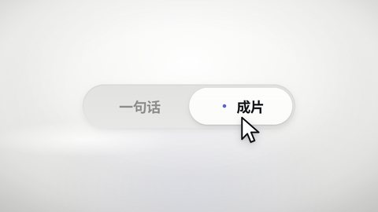</a> 
<b>分段滑块切换</b> 
<code>segmented-thumb-hero</code> 
一个两段胶囊分段控件从下方弹簧浮入，超大箭头光标从右下画外滑入点击，白色滑块 8 帧滑到右段（带拉伸和速度拖影），点击处散开一圈强调色细环。 
4.0 秒 · 9 个字段
</td>
</tr>
<tr>
<td id="theme-switch-moves-sweep" width="33%" valign="top">
 
<b>斜扫昼夜换肤</b> 
<code>theme-switch-moves-sweep</code> 
一块 1680×912 的周排期窗口：镜头先贴近右上角的日夜开关按下，夜色以 15° 斜边从右往左扫过整个画面，相机同时拉开；扫完后今天、此刻线和窗口轮廓光依次亮起，最后停在夜景里缓推。 
5.0 秒 · 15 个字段 · 可换图
</td>
<td id="ui-to-brand-morph-icon-flip-bloom" width="33%" valign="top">
 
<b>图标翻转变标</b> 
<code>ui-to-brand-morph-icon-flip-bloom</code> 
一张图先蓄力晃两下，沿 Y轴翻扁成竖线，翻过最薄处换成另一张图、带过冲撑开，字标随即逐字由大变小落定；开始图标、结尾标志、字标、三种颜色和字号都能在检查器里改，没填图时画中性的占位方块和圆环。 
4.5 秒 · 8 个字段 · 可换图
</td>
<td id="ui-to-brand-morph-input-morph-assemble" width="33%" valign="top">
 
<b>输入框拼成标志</b> 
<code>ui-to-brand-morph-input-morph-assemble</code> 
一只消息输入框点发送后，文案加速飞出，墨色从发送键漫开灌满，输入框收成你的 logo外接竖框；logo按纵向切成三条横条，错峰从画外落进虚线槽位拼成整图，再左移给字标让位，口号跟在下面升起。 
5.5 秒 · 11 个字段 · 可换图
</td>
</tr>
</table>

## 卡片与场景 · 28 张

轮播、发牌、照片墙、俯拍桌面和 3D 场景这类画面主体卡。

<table>
<tr>
<td id="avatar-bracket-carousel" width="33%" valign="top">
 
<b>取景框换头像</b> 
<code>avatar-bracket-carousel</code> 
「你的 ⬜ 团队」填空句式：四角对焦框锁定头像槽，一列圆头像从下往上 spring 轮换（入框放大清晰、出框缩小虚化），头像下的角色标签同步滚动换字。 
5.0 秒 · 10 个字段 · 可换图
</td>
<td id="basic-3d-scene" width="33%" valign="top">
 
<b>三维章节漫游</b> 
<code>basic-3d-scene</code> 
几张章节卡散布在三维空间里，相机逐站飞行对齐，最后拉远总览落版；每站停留时卡底金色进度线走满。 
8.5 秒 · 15 个字段 · 可换图
</td>
<td id="brand-frame-snap" width="33%" valign="top">
<a href="templates/cards-scenes/brand-frame-snap">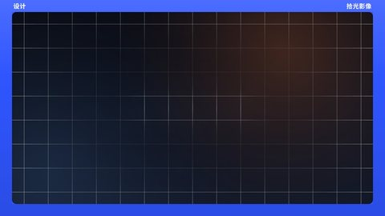</a> 
<b>彩框包屏翻色</b> 
<code>brand-frame-snap</code> 
叠在你的录屏上的一圈粗品牌色画框：四条实体色带在 0–18 帧从零长满，左上角标从框带下沿升起，84 帧整圈同帧从设计色硬翻成开发色、角标同帧换字，接 3 帧径向白闪和框厚阻尼弹跳，然后静止。 
4.5 秒 · 10 个字段 · 可换图 · 叠加层
</td>
</tr>
<tr>
<td id="card-flip-reveal" width="33%" valign="top">
 
<b>功能卡翻面报数</b> 
<code>card-flip-reveal</code> 
一排暗色功能卡逐张沿纵轴翻面：先反向预备，再加速翻 194° 过冲、弹簧落回 180°，翻成瓷白结论卡——大号结论数字、「之前／用上之后」对照条和结论标签依次落定，卡下镜面地板有同步翻转的倒影。 
5.0 秒 · 12 个字段
</td>
<td id="card-flock-tumble" width="33%" valign="top">
 
<b>卡群翻飞收束</b> 
<code>card-flock-tumble</code> 
一叠照片卡从近 90° 的侧棱薄边翻飞进来，沿一条样条翻到阶梯站定后继续慢转，10 帧吸进中心；同时亮起白热闪核和一圈湍流烟雾环，巨字带渐变砸入，标语和品牌眉题随后落定。 
4.5 秒 · 14 个字段 · 可换图
</td>
<td id="card-stack" width="33%" valign="top">
 
<b>卡片弹入展扇</b> 
<code>card-stack</code> 
一摞圆角图片卡从画面下方逐张弹入叠齐，再展开成扇面；正中那张被抽出 72px，描上一圈钴蓝边、扫过一道光，标题和副句随后升起。 
5.0 秒 · 11 个字段 · 可换图
</td>
</tr>
<tr>
<td id="carousel-3d" width="33%" valign="top">
 
<b>3D 环形画廊</b> 
<code>carousel-3d</code> 
卡片围成一圈转动，正前方的一张点亮，环下大字幕随步进上滚换字；图片、卡片名称、底色、卡面色、强调色、文字色和字幕字号都能在检查器里改。 
5.6 秒 · 11 个字段 · 可换图
</td>
<td id="cloner-depth-echo" width="33%" valign="top">
 
<b>分身纵队</b> 
<code>cloner-depth-echo</code> 
一张主卡「复印」出一列重影弹向纵深（消失点在左上），停一拍后全体加速吸回本体，合体时主卡脉冲、序号格全亮、左下计数回弹，标题随后升起。 
4.5 秒 · 12 个字段 · 可换图
</td>
<td id="deck-deal-flyin" width="33%" valign="top">
 
<b>牌堆发卡满板</b> 
<code>deck-deal-flyin</code> 
一张石墨桌面上，一摞有厚度的实体卡特写环绕 → 一拍预备 → 一摞卡按硬加速节拍甩进奶白板上的 3 列网格，相机追着发牌升起、后仰成跑道式俯瞰，满板后左下标语升起。 
5.0 秒 · 12 个字段 · 可换图
</td>
</tr>
<tr>
<td id="depth-layer-moves" width="33%" valign="top">
 
<b>分层视差滑轨</b> 
<code>depth-layer-moves</code> 
整页截图拆成远景、中景卡组和近景标签三层，在同一条滑轨上以 0.35 / 0.7 / 1.4 的速度差滑过固定画框；落定时主角卡停在画面正中，抬起、加深描边并落下角标，画面上的眉标、标题和副句始终不动。 
5.5 秒 · 16 个字段 · 可换图
</td>
<td id="element-body-moves" width="33%" valign="top">
 
<b>抬卡点选</b> 
<code>element-body-moves</code> 
几张竖版卡片平躺在冷白桌面上，斜俯拍镜头逐张点名（抬起、悬停、落回），选定的那张沿桌面法线抬起停在空中，带对勾和钴蓝描边，接触核和环境影两层影子留在桌面。 
5.0 秒 · 13 个字段 · 可换图
</td>
<td id="fracture" width="33%" valign="top">
<a href="templates/cards-scenes/fracture">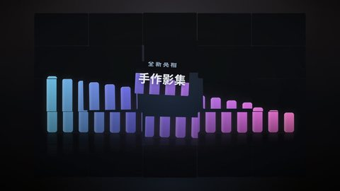</a> 
<b>碎片拼合海报</b> 
<code>fracture</code> 
一片碎片从四面八方翻滚飞入，按离中心的距离波纹式拼成一张整海报（5×5 瓦片，网格可调），落位时带「咔哒」小摆，随后整海报极缓推近、海报上的眉题和主名亮起；片段结尾碎片沿背离中心方向加速旋出。 
4.0 秒 · 9 个字段 · 可换图
</td>
</tr>
<tr>
<td id="icon-field-colorize" width="33%" valign="top">
 
<b>满屏图标点亮</b> 
<code>icon-field-colorize</code> 
满屏熄灯的键帽图标从中心向外浮现，停一拍后四道色波自上而下把全场点亮成金到珊瑚的四段横带，最后暗幕里升起眉题和两行标题。 
6.0 秒 · 11 个字段
</td>
<td id="impact-feedback-anime-impact" width="33%" valign="top">
<a href="templates/cards-scenes/impact-feedback-anime-impact">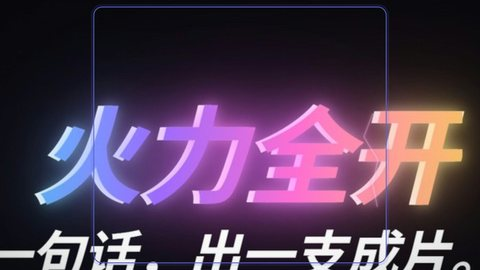</a> 
<b>负片打击帧急推</b> 
<code>impact-feedback-anime-impact</code> 
一记重拳打在一张画面上：镜头先缓慢推进、锁定中央偏上的目标框，短促回拉后六帧急推撞停；三帧整幅负片 + 手绘放射集中线 + 红青色散，随后恢复干净特写并震屏衰减。 
4.0 秒 · 5 个字段 · 可换图
</td>
<td id="magician-card-flourish" width="33%" valign="top">
 
<b>星芒变出卡</b> 
<code>magician-card-flourish</code> 
深蓝午夜舞台上先闪出一枚蓝色星芒，卡从光里被甩出来，沿慢进弧线飞出、绕自己的对角轴转十三整圈后硬定格，落点炸开一圈光脉冲、一道斜向扫光，右侧文案随后逐行浮出。 
5.5 秒 · 16 个字段 · 可换图
</td>
</tr>
<tr>
<td id="mosaic-reframe" width="33%" valign="top">
 
<b>瓦片三态重排</b> 
<code>mosaic-reframe</code> 
一组照片在三种排版之间连续重排：规则网格、一张主图带图注的拼贴、沿对角线摊开的相纸瀑布。 
7.5 秒 · 18 个字段 · 可换图
</td>
<td id="neon-frame-forerun" width="33%" valign="top">
 
<b>描框贴落登场</b> 
<code>neon-frame-forerun</code> 
霓虹框从左缘中点分两路奔画，在右缘相撞闪一下，面板由暗转亮，标题、副标题和截图面板带着同形软影从3D上空错峰贴落；勾上「环绕齐落」就换成机位从左绕到右、三件同帧起落。 
4.5 秒 · 12 个字段 · 可换图
</td>
<td id="outro-group-photo-launch" width="33%" valign="top">
 
<b>群图飞聚收场</b> 
<code>outro-group-photo-launch</code> 
4–9 张合影图从四面八方带旋转飞入，每张落进一张白卡，围成一圈把字标让在中间；字标逐字压印、全员退后一步，crane 落机位，配开场光带、舞台光和上飘金尘。 
5.0 秒 · 12 个字段 · 可换图
</td>
</tr>
<tr>
<td id="overhead-camera-moves-tabletop-drop" width="33%" valign="top">
 
<b>桌面巡视扎入</b> 
<code>overhead-camera-moves-tabletop-drop</code> 
俯拍一张石墨台面：3–5 张桌面截图平铺成样稿卡阵，相机横滑巡视、选中目标页后骤降扎入，落版成一张占画面 96% 宽的大页；页名作为印刷标签贴在每张样稿下沿。 
5.0 秒 · 7 个字段 · 可换图
</td>
<td id="overhead-camera-moves-tilt-reveal" width="33%" valign="top">
 
<b>俯拍抬正揭示</b> 
<code>overhead-camera-moves-tilt-reveal</code> 
一张 16:9 页面截图平躺在深蓝舞台上，开场只见上缘一道发光的窄带；镜头从 86° 抬头回正，页面由远及近落定，背景光池和浮尘反向视差，落定后极缓推近。 
4.0 秒 · 4 个字段 · 可换图
</td>
<td id="page-waterfall-wall" width="33%" valign="top">
 
<b>瀑布墙滚动</b> 
<code>page-waterfall-wall</code> 
三列页面截图排在向后倾的墙面上，各自差速循环滚动（中列反向），镜头缓慢推近，墙后一团靛蓝余光，上下柔进柔出；填 6–12 张截图最合适（少于 6 张也能跑，但墙会稀），一张不填就显示暗色占位卡；截图、背景色、余光色和卡片纸色都能在检查器里改。 
5.0 秒 · 5 个字段 · 可换图
</td>
</tr>
<tr>
<td id="panel-grid-moves" width="33%" valign="top">
 
<b>漫画斜格分屏</b> 
<code>panel-grid-moves</code> 
漫画分格：开场全屏轻推，20/24/28 三拍被 12° 斜缝切成三格，格子硬切弹入带白闪，三个旁白框盖章落下；定格后三格极缓推近，末格反拉一下再斜边吃屏，图片放大滑到右半屏，左侧升起两行片尾标题和副句。 
5.2 秒 · 14 个字段 · 可换图
</td>
<td id="product-card-progressive-assemble" width="33%" valign="top">
 
<b>详情卡逐格自填</b> 
<code>product-card-progressive-assemble</code> 
一张商品详情卡被填充光标逐格填好：棚拍图、商品名、分类标签、价格降级、正文马克笔、色卡和按钮依次落位，整卡缓慢前推后停住。 
6.0 秒 · 20 个字段 · 可换图
</td>
<td id="research-card-stack-scroll" width="33%" valign="top">
<a href="templates/cards-scenes/research-card-stack-scroll">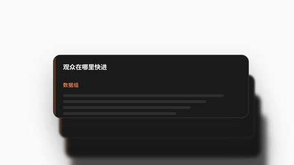</a> 
<b>资料卡叠压滚入</b> 
<code>research-card-stack-scroll</code> 
一张张资料卡（0.4 秒一张）从正上方竖直滚入并依次压叠：新卡从镜头前方落下，旧卡后退缩小、略微变暗，只有正在读的那张带投影和作者行/四根摘要骨架线；背景浅灰格线同速滚动。 
5.0 秒 · 8 个字段
</td>
</tr>
<tr>
<td id="spotlight-hero-card" width="33%" valign="top">
 
<b>聚光锁定主角</b> 
<code>spotlight-hero-card</code> 
石墨黑剧场里，一页卡片墙先被暖白聚光灯扫过，最后锁定其中一张：相机 18 帧推进到斜侧特写，卡弹起、悬停、亮两圈香槟金轮廓光，再贴回页面落定，卡旁的两行大字带着香槟色马克条一起落回。 
6.0 秒 · 14 个字段 · 可换图
</td>
<td id="steep-tilt-glide" width="33%" valign="top">
 
<b>长图斜墙滑过</b> 
<code>steep-tilt-glide</code> 
一面陡斜的墙横着滑过固定镜头：1–8 张截图裁成统一屏宽拼成一堵斜墙，依次滑过，带速度重影、起始压暗揭亮、左缘景深雾和暗角。 
4.5 秒 · 9 个字段 · 可换图
</td>
<td id="wall-reveal-moves-bento" width="33%" valign="top">
 
<b>便当格逐格点亮</b> 
<code>wall-reveal-moves-bento</code> 
暗场里一面便当格墙压暗待命，琥珀彗星流光逐格绕边框一圈，描边过半时格内图片 back-out 弹出、提亮；第一格点亮时标题跟着提亮，全部点亮后整面墙 1→1.04 缓推收住。 
5.0 秒 · 11 个字段 · 可换图
</td>
</tr>
<tr>
<td id="wall-reveal-moves-wireframe" width="33%" valign="top">
<a href="templates/cards-scenes/wall-reveal-moves-wireframe">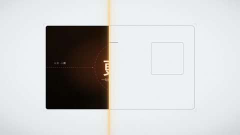</a> 
<b>线框扫描显影</b> 
<code>wall-reveal-moves-wireframe</code> 
图纸底上先描出一个居中的大框和中性版面骨架，四角裁切标记跟着落位；随后一条琥珀扫描线从左向右扫过，用户的图片在框内按扫描前沿一点点显影，身后拖着一段渐隐暖光。 
5.0 秒 · 5 个字段 · 可换图
</td>
</tr>
</table>

## 转场与光效 · 15 张

光轨、聚光、故障、溶解、印刷和空间转场。

<table>
<tr>
<td id="bottom-push-stack-wipe" width="33%" valign="top">
 
<b>换章底推上屏</b> 
<code>bottom-push-stack-wipe</code> 
章节海报从底边整屏向上推入，把上一章刚性顶出画外：整块饱和色板、上缘受光边和接缝阴影、整摞速度模糊，标题在落定前逐行升起，说明随后淡入，尾段极缓推近。 
5.5 秒 · 8 个字段 · 可换图
</td>
<td id="glitch-cycle" width="33%" valign="top">
 
<b>乱码轮播状态</b> 
<code>glitch-cycle</code> 
一行固定槽位的状态短语轮播：每条开头和结尾被乱码熔断、中段偶发抽字，切换时叠 RGB分离、整行抖动和水平撕裂；底部进度条走满，末条收干净后状态转「已完成」、署名升起。 
6.0 秒 · 16 个字段
</td>
<td id="glow-flyline-moves-flyline-arc" width="33%" valign="top">
<a href="templates/transitions/glow-flyline-moves-flyline-arc">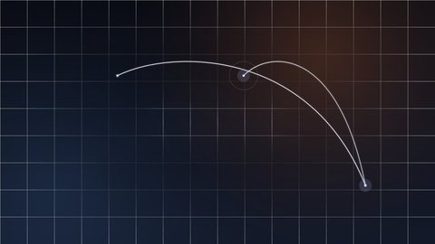</a> 
<b>卡片飞线连接</b> 
<code>glow-flyline-moves-flyline-arc</code> 
叠在你自己的仪表盘或卡片画面上的一组发光飞线：每条从起点亮起锚点，长出一段带亮头和彗尾的弧线，到站留下一个节点和一圈冲击环，第二条线接着打到下一站。 
4.5 秒 · 4 个字段 · 叠加层
</td>
</tr>
<tr>
<td id="glow-flyline-moves-glow-orb-ambient" width="33%" valign="top">
 
<b>暗场光斑呼吸</b> 
<code>glow-flyline-moves-glow-orb-ambient</code> 
深色舞台上三团低饱和光斑缓慢呼吸、交错漂移，中间一块磨砂玻璃卡，卡面铺一张你的图（四周留一圈玻璃边），标题和副标压在左下；光斑从卡后游过，卡缘按最近的一团泛起微光，镜头极缓推进后收敛定格。 
5.5 秒 · 10 个字段 · 可换图
</td>
<td id="glow-flyline-moves-orb-flyline-relay" width="33%" valign="top">
 
<b>光斑飞线接力</b> 
<code>glow-flyline-moves-orb-flyline-relay</code> 
午夜蓝黑场上几颗圆形玻璃节点横向排开，节点间一条条拱形飞线依次长出、带着亮头和彗尾接力到下一站；落点那一帧节点点亮，背后的光斑同时涨亮一拍，随后飞线散成一串细点。 
5.5 秒 · 11 个字段
</td>
<td id="gradient-transition" width="33%" valign="top">
 
<b>渐变三段变奏</b> 
<code>gradient-transition</code> 
暗底上三类 CSS 渐变轮流变奏：linear 角度扫过、radial 光斑对角游走聚焦、conic 三色环越转越慢落定，窄交叉淡化换段不停顿；前景两段大字逐字从虚焦升起，第三段是字距收拢的品牌名加一行副句。 
6.5 秒 · 11 个字段
</td>
</tr>
<tr>
<td id="grain-dissolve" width="33%" valign="top">
<a href="templates/transitions/grain-dissolve">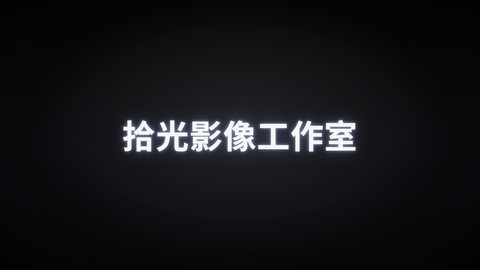</a> 
<b>砂化凝聚字标</b> 
<code>grain-dissolve</code> 
一行干净的字标先砂化成沸腾的颗粒噪点，带斜纹和像素角柄的选区框展开又撤走，噪点随后凝聚成更大号的短字标，位移衰减、辉光冲高回落，凝固成清晰的发光字标。 
3.0 秒 · 9 个字段
</td>
<td id="light-play-moves-sheen-sweep" width="33%" valign="top">
 
<b>卡片扫光加冕</b> 
<code>light-play-moves-sheen-sweep</code> 
米色展台上一张钛黑卡从下方升起、缓缓转向光源，一道斜向高光带在卡面上扫过一次，扫过的地方拉丝纹和蚀刻字被照亮；左边一栏眉题、标题、正文和按钮依次入场。 
5.0 秒 · 18 个字段 · 可换图
</td>
<td id="light-play-moves-spotlight-sweep" width="33%" valign="top">
 
<b>聚光扫亮标题</b> 
<code>light-play-moves-spotlight-sweep</code> 
剧场首映夜：酒红天鹅绒幕布前一盏钨丝追光像钟摆一样摆动，光扫到哪里，哪里的大标题就被照亮（暗场里只留一层几乎看不见的字影）；停稳后光圈张开、整行全亮，眉题和副标跟着入场，副标下可以放标志。 
6.0 秒 · 14 个字段 · 可换图
</td>
</tr>
<tr>
<td id="print-texture-transitions" width="33%" valign="top">
<a href="templates/transitions/print-texture-transitions">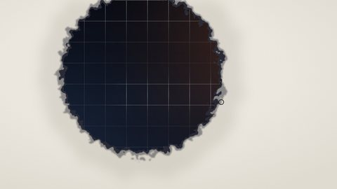</a> 
<b>墨渗揭示转场</b> 
<code>print-texture-transitions</code> 
纸面章节页被一滴墨从落点洇开，墨洞是透明的，洞外的纸面慢慢退去，洞里直接透出下面那轨的下一段；纸纹、字和发丝线都在旧景里，墨边和湿晕压在洞沿上。 
3.5 秒 · 11 个字段 · 叠加层
</td>
<td id="radial-wave" width="33%" valign="top">
<a href="templates/transitions/radial-wave">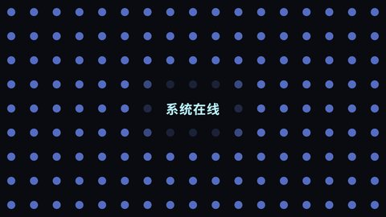</a> 
<b>点阵通电涟漪</b> 
<code>radial-wave</code> 
暗底点阵从波源向外错峰通电点亮（每点胀大到 1.5 倍再落回），随后一道亮色脉冲从外圈反向收拢回波源、峰值换色带光晕，最后可留一行文字在中心淡入停住。 
4.0 秒 · 9 个字段
</td>
<td id="spotlight-sweep-moves-corner-reveal" width="33%" valign="top">
 
<b>角落聚光显影</b> 
<code>spotlight-sweep-moves-corner-reveal</code> 
黑场上，一团聚光从左上角匀速扩张、光心往右下漂，照到的地方画面逐渐显影，最后整屏亮起并定格。 
4.5 秒 · 5 个字段 · 可换图
</td>
</tr>
<tr>
<td id="spotlight-sweep-moves-glow-wake-sleep" width="33%" valign="top">
 
<b>聚光醒睡扫过</b> 
<code>spotlight-sweep-moves-glow-wake-sleep</code> 
黑场里一块斜置的界面截图面板从黑暗中醒来：一道带辉光的紫色光线贴着面板顶边从左匀速扫到右，光到哪里哪里亮，面板同时慢慢向右漂，光头接近右缘时右缘转蓝紫；片段最后 800ms 自己沉回黑暗（环境光降 0、贴边光淡出）。 
5.0 秒 · 5 个字段 · 可换图
</td>
<td id="spotlight-sweep-moves-slide-pan" width="33%" valign="top">
<a href="templates/transitions/spotlight-sweep-moves-slide-pan">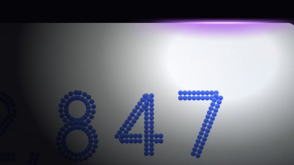</a> 
<b>贴边泛光横摇</b> 
<code>spotlight-sweep-moves-slide-pan</code> 
黑场里一块 3000×1400 的超宽界面板匀速向左滑（相机向右摇），一道紫色聚光贴着面板左缘爬上左上角，再转过角沿顶边一路扫到右段；光到哪里面板哪里显影，聚光范围外沉进黑色，片段最后停止左移并定格，由宿主统一上飘淡出。 
4.8 秒 · 5 个字段 · 可换图
</td>
<td id="transition-travel" width="33%" valign="top">
 
<b>字腔穿越转场</b> 
<code>transition-travel</code> 
暖黑字卡把大字挖成字腔，洞里透出下面那轨的下一段；镜头指数推进钻进最厚的一条竖笔，盖板在76–86帧淡出，之后只剩下一段。 
5.0 秒 · 10 个字段 · 叠加层
</td>
</tr>
</table>
