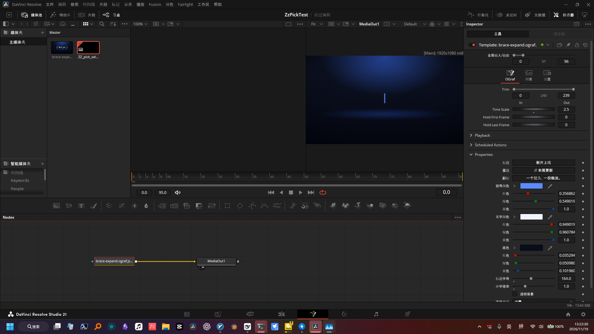
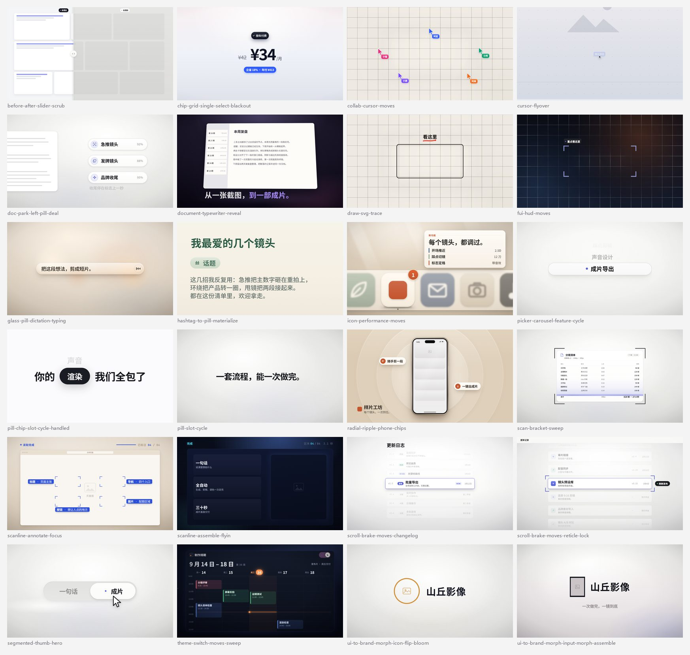
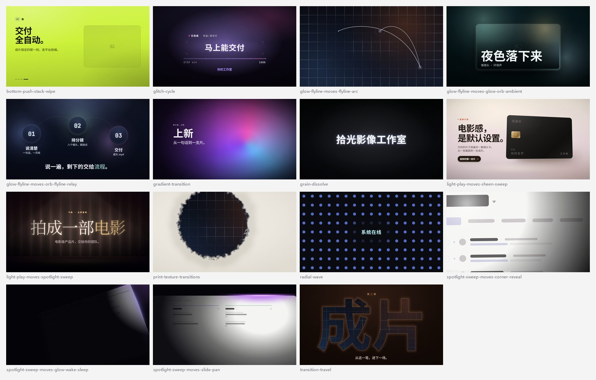

# DaVinci Resolve OGraf 模板库

> 117 张动态图文卡，导入达芬奇就能改字、改色、改字体。

这套卡是给 DaVinci Resolve 21 做的 [OGraf](https://ograf.ebu.io) 图形：标题、数据、列表、图表、转场都有，媒体池导入即用，不用装插件，也不用另外找字体。全部改编自开源项目 video-shotcraft 的镜头卡，在 21.1.1 和 21.1.2 上逐张验收过。


| | |
|---|---|
| 软件 | DaVinci Resolve 21（21.1.1、21.1.2 实测） |
| 图形格式 | OGraf v1 |
| 内容 | 117 张卡，分 7 类，另加 marker 测试卡两个版本 |
| 许可 | Apache License 2.0，内置字体为 SIL OFL 1.1 |

## 这套卡的特点

- **字段全在检查器里。** 标题、强调词、数字、小字、配色、字号、字体预设都能改，动画节奏跟着参数走，不用进 Fusion 节点。
- **字体随包。** 每张卡自带 Noto 宋体／黑体的字体切片，目标机器不装字体也不跑版；字体预设还能切到楷体等风格。
- **片段长度随意。** 动效只取决于播放头位置，入场和出场按片段首尾对齐，剪多长都成立。
- **按用途分类。** 117 张卡按用途分成 7 类，找卡时按「标题、数据、界面、转场」这样的目的去翻就行。

## 快速开始

1. 打开达芬奇，进入「媒体」页
2. 在媒体池空白处右键，选择「导入媒体」，选中某张卡目录里的 `<模板名>.ograf.json`
3. 把导入的图形拖到时间线上并选中
4. 在检查器里改文案、颜色、字号和字体预设，拖动播放头预览

同一个图形可以多次拖到时间线，每个实例的字段各自独立。

## 在达芬奇里改参数

卡片导入后就是一个普通 OGraf 图形。选中它，检查器右侧就是全部参数，改完立刻在监视器里生效，不用进 Fusion 节点。下面是 21.1.2 里的实拍，窗口左侧是媒体池，时间线上是导入的卡：



下拉字段在 21.1.2 里是真正的下拉菜单，例如 marker 卡的「背景」：


常见字段：

| 字段 | 用途 |
|---|---|
| 标题、强调词、数字、小字 | 卡片正文；强调词自动换成强调色，英文强调词转斜体 |
| 文字颜色、强调色、纸面色／背景色、卡片色 | 按品牌或主题改配色 |
| 字体预设、字体、字号、小字倍率 | 一键换字体风格；小字倍率统一缩放辅助信息 |
| 透明背景 | 去掉底色，叠加在实拍素材上 |
| 卡片、叙事标题、眉题、数据组、脚注 | 图表与结构化卡片的内容字段 |

每张卡的字段不完全相同，以检查器实际显示为准。

## 动起来看看

下面这些动图由同一份 OGraf 包离屏渲染，和达芬奇里看到的是同一套动画。前景与转场类的卡不带背景，动图里垫的是自绘演示底，实际使用时叠在实拍素材上。

| | |
|:--:|:--:|
|  |  |
| **paper-title-card** 纸面压印标题 | **deck-deal-flyin** 发牌成墙 |
|  |  |
| **chart-live-moves-dot-swarm** 点阵数字生长 | **carousel-3d** 3D 卡片轮播 |
|  |  |
| **glow-flyline-moves-orb-flyline-relay** 光轨接力 | **collab-cursor-moves** 协作光标 |
|  |  |
| **fui-hud-moves** HUD 标注 | **print-texture-transitions** 印刷质感转场 |
|  | |
| **transition-travel** 空间转场 | |

## 分类浏览

七类按用途划分，每类配一张缩略图拼图，点开列表可以看完整模板名。

### 标题与版式 · 10 张

开场标题、套印字标、文字里嵌画面、标题降级成标签这类版式卡。


<details>
<summary>全部 10 张</summary>

- aurora-bloom-bg-flip
- blur-slide
- brand-ink-open
- logo-shrink-wordmark-lockup
- orbit-ring-title-open
- paper-title-card
- riso-print-hits
- text-as-mask
- title-demote-to-label
- white-flash-logo-simplify-cut

</details>

### 文字动效 · 22 张

逐词浮现、打字机、装配、压入、卡拉 OK 填色等，文字本身的入场与节奏。


<details>
<summary>全部 22 张</summary>

- assemble-then-type-flyin
- brace-expand
- flying-words
- gradient-word-sweep
- lead-word-zoom-assemble
- letterspace-materialize
- neon-triple-marquee
- outline-word-fill
- slam-entrance-moves-impact
- slam-entrance-moves-kanada
- stroke-segment-build
- text-column-converge
- type-assembly-moves-drift-assembly
- type-assembly-moves-split-stagger
- type-assembly-moves-text-on-path
- type-entrance-moves
- type-rhythm-sync-font-weight-pump
- type-rhythm-sync-karaoke-fill-sync
- typewriter-moves
- vertical-word-roll-blur-cycle
- word-relay-filmstrip
- word-relay-geometry

</details>

### 数据与图表 · 14 张

仪表、折线、点阵数字、时间线和信息图。


<details>
<summary>全部 14 张</summary>

- bezier-source-converge-merge
- chart-live-moves-axis-rescale
- chart-live-moves-dot-swarm
- chart-live-moves-oscilloscope
- countdown-arc-scatter
- dataviz-landscape-open
- gauge-readout-moves-needle
- gauge-readout-moves-tape
- impact-feedback-hit-counter
- integration-hub-map
- slam-entrance-moves-score
- timeline-travel
- value-stagger-gradient
- voice-waveform-live

</details>

### 列表与步骤 · 4 张

菜单、步骤条、表格行这类条理内容的入场。


<details>
<summary>全部 4 张</summary>

- beat-step-list-theme-cycle
- list-reveal
- list-stack-press
- row-embed

</details>

### 界面与交互 · 24 张

光标、HUD、扫描标注、下拉、药丸、滑块，界面演示与叠加标注。



<details>
<summary>全部 24 张</summary>

- before-after-slider-scrub
- chip-grid-single-select-blackout
- collab-cursor-moves
- cursor-flyover
- doc-park-left-pill-deal
- document-typewriter-reveal
- draw-svg-trace
- fui-hud-moves
- glass-pill-dictation-typing
- hashtag-to-pill-materialize
- icon-performance-moves
- picker-carousel-feature-cycle
- pill-chip-slot-cycle-handled
- pill-slot-cycle
- radial-ripple-phone-chips
- scan-bracket-sweep
- scanline-annotate-focus
- scanline-assemble-flyin
- scroll-brake-moves-changelog
- scroll-brake-moves-reticle-lock
- segmented-thumb-hero
- theme-switch-moves-sweep
- ui-to-brand-morph-icon-flip-bloom
- ui-to-brand-morph-input-morph-assemble

</details>

### 卡片与场景 · 28 张

轮播、发牌、照片墙、俯拍桌面和 3D 场景这类画面主体卡。


<details>
<summary>全部 28 张</summary>

- avatar-bracket-carousel
- basic-3d-scene
- brand-frame-snap
- card-flip-reveal
- card-flock-tumble
- card-stack
- carousel-3d
- cloner-depth-echo
- deck-deal-flyin
- depth-layer-moves
- element-body-moves
- fracture
- icon-field-colorize
- impact-feedback-anime-impact
- magician-card-flourish
- mosaic-reframe
- neon-frame-forerun
- outro-group-photo-launch
- overhead-camera-moves-tabletop-drop
- overhead-camera-moves-tilt-reveal
- page-waterfall-wall
- panel-grid-moves
- product-card-progressive-assemble
- research-card-stack-scroll
- spotlight-hero-card
- steep-tilt-glide
- wall-reveal-moves-bento
- wall-reveal-moves-wireframe

</details>

### 转场与光效 · 15 张

光轨、聚光、故障、溶解、印刷和空间转场。



<details>
<summary>全部 15 张</summary>

- bottom-push-stack-wipe
- glitch-cycle
- glow-flyline-moves-flyline-arc
- glow-flyline-moves-glow-orb-ambient
- glow-flyline-moves-orb-flyline-relay
- gradient-transition
- grain-dissolve
- light-play-moves-sheen-sweep
- light-play-moves-spotlight-sweep
- print-texture-transitions
- radial-wave
- spotlight-sweep-moves-corner-reveal
- spotlight-sweep-moves-glow-wake-sleep
- spotlight-sweep-moves-slide-pan
- transition-travel

</details>

拼图里大部分帧来自达芬奇的验收渲染；brand-frame-snap、collab-cursor-moves、fui-hud-moves、glow-flyline-moves-flyline-arc、print-texture-transitions、transition-travel 和 draw-svg-trace 这几张不带背景，为看清效果垫了自绘的演示底，实际使用时是叠在实拍素材上的。

## marker 测试卡

marker-underline-title 是这套卡的第一张，用来验证字段和渲染链路。v0.2 加入「背景」下拉字段，是整库唯一使用 select 字段的卡。


| 版本 | 目录 | 预览 |
|---|---|---|
| v0.1 | `templates/marker-underline-title/` | [视频](previews/marker-underline-title-preview.mp4) |
| v0.2 | `templates/marker-underline-title-v0.2/` | [视频](previews/marker-underline-title-v0.2-preview.mp4) |

与原镜头卡的对比：[marker-underline-title-vs-original.png](previews/marker-underline-title-vs-original.png)

## 兼容性

| 项目 | 状态 |
|---|---|
| DaVinci Resolve 21.1.1 | 全库实测通过；select 字段显示为文本框 |
| DaVinci Resolve 21.1.2 | 全库实测通过；select 字段变为下拉 |
| 更高的 21.x 版本 | 未逐一验证 |
| 竖屏工程 | 抽查通过，卡面不出框 |

## 目录结构

```
templates/
  titles/         标题与版式
  type-moves/     文字动效
  data/           数据与图表
  lists/          列表与步骤
  ui/             界面与交互
  cards-scenes/   卡片与场景
  transitions/    转场与光效
  marker-underline-title/      测试卡 v0.1
  marker-underline-title-v0.2/ 测试卡 v0.2
docs/             18 份制作说明、验收清单与修改记录
previews/
  categories/     每类一张缩略图拼图
  showcase/       9 张动图
  resolve/        达芬奇检查器截图
```

每张卡的目录里至少有 `<模板名>.ograf.json`、`graphic.mjs`、`fonts/`、`NOTICE.md` 和上游许可证。docs 里的「第 X 批」是当时的制作顺序，现在只当制作记录看，和分类无关。

## 来源与许可

**本仓库以 [Apache License 2.0](LICENSE) 发布。**

- 全部卡片改编自 [video-shotcraft](https://github.com/Vincentwei1021/video-shotcraft)（Vincentwei1021，Apache-2.0）的镜头卡，从 Remotion 合成改写为 OGraf v1 图形；每张卡内保留 `NOTICE.md` 与上游许可证全文
- 字体为 Noto Serif SC、Noto Sans SC、JetBrains Mono，SIL Open Font License 1.1，许可证随字体目录
- 打包运行时依赖 React、React DOM、scheduler，MIT License
- OGraf 为 EBU 维护的开放图形规范，见 https://ograf.ebu.io

## 文档与验收记录

`docs/` 保留了这套卡从制作到验收的全过程，比较常看的有：

- [媒体夹索引](docs/媒体夹索引.md)：全部卡的内容与用法索引
- [修复记录](docs/修复记录-20261117.md)：全库字体预设与细节修复
- [验收清单（第三到九批）](docs/验收清单-第三到九批.md)
- [人眼验收（第三到九批）](docs/人眼验收-第三到九批.md)
- [自动验收（全库）](docs/自动验收-全库-20261117.md)
- [动效重做：research-card-stack-scroll](docs/动效重做-research-card-stack-scroll-20261118.md)
- 每批的达芬奇试用清单见 `docs/达芬奇试用清单-第X批.md`

## 范围说明

本仓库只包含模板成品。生成器工程（构建脚本与兼容层，可用于重新构建全部卡片）、验收渲染和参考素材体积较大，未纳入仓库，另行备份。
