# DaVinci Resolve OGraf 模板库

> 118 张动态图文卡，导入达芬奇就能改字、改色、改字体。

给 DaVinci Resolve 21 用的 [OGraf](https://ograf.ebu.io) 图形模板：标题、文字动效、图表、界面标注、转场都有。媒体池导入即用，不装插件，字体随包。全部改编自开源项目 [video-shotcraft](https://github.com/Vincentwei1021/video-shotcraft) 的镜头卡。

118 ready-to-use OGraf motion-graphics templates for DaVinci Resolve 21: titles, kinetic type, charts, UI callouts and transitions. Import a card's `.ograf.json`, then edit text, colours and fonts in the Inspector. Field labels are in Chinese.


**第一次用先下入门包：** [ograf-starter（12 张，55 MB，解压即用）](https://github.com/yoruuuchan/davinci-ograf-templates/releases/latest)。想要全部 118 张：[ograf-templates-all（15 MB）](https://github.com/yoruuuchan/davinci-ograf-templates/releases/latest)。免费开源（[Apache License 2.0](LICENSE)），需要达芬奇 21 或更新。

**目录：** [上手](#上手) · [不知道选哪张](#不知道选哪张) · [在达芬奇里改](#在达芬奇里改) · [动起来看看](#动起来看看) · [分类浏览](#分类浏览) · [验收与兼容](#验收与兼容) · [常见问题](#常见问题) · [已知限制](#已知限制) · [目录结构](#目录结构) · [来源与许可](#来源与许可)

## 上手

第一次用就三步。下面三张图是同一个达芬奇窗口，亮框的地方照着操作。

### 第一步 · 把卡导入媒体池

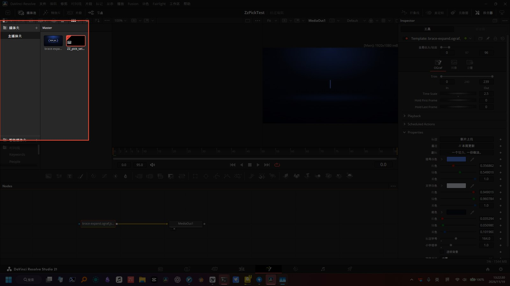

达芬奇左下角这块是媒体池，放素材和导入文件都在这。空白处右键 →「导入媒体」，选某张卡目录里的 `<模板名>.ograf.json`。整张卡的文件夹（连同 `fonts`）放在固定位置，之后别再挪。

### 第二步 · 拖到时间线

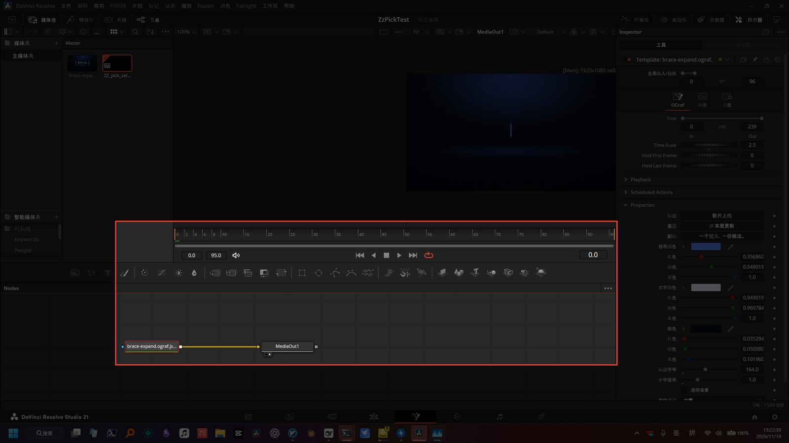

把导入的卡拖到时间线的轨道上，用鼠标选中它。

### 第三步 · 在检查器里改

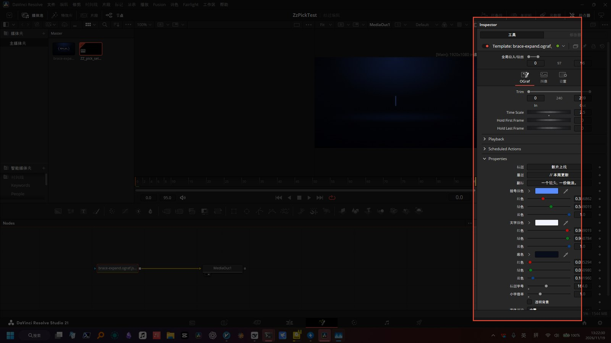

右边这块是检查器，这张卡所有参数都在这里：标题、颜色、字号、字体预设。改完在监视器里立刻生效。

### 三个词

| 词 | 什么意思 |
|---|---|
| OGraf | 达芬奇 21 认的开放图形格式。一张卡就是一个 `.ograf.json` 加一个字体文件夹，不是插件，不用安装 |
| 媒体池 | 达芬奇左下角放素材的区域，导入的文件都在这里 |
| 检查器 | 达芬奇右侧的参数面板，选中时间线上的卡后在这里改 |

### 下哪个包

| 下载 | 内容 | 大小 |
|---|---|---|
| `ograf-starter` .zip | 12 张，七类各至少一张 | 55 MB，解压就能用 |
| `ograf-templates-all` .7z | 全部 118 张 | 15 MB，解压后约 600 MB |

全库包反而更小：每张卡各带一份字体，同样的字体重复了上百遍，.7z 能把重复压掉，.zip 不能。Windows 11（23H2 起）自带 .7z 解压，其他系统用 [7-Zip](https://www.7-zip.org)，或者直接用入门包。

同一个图形可以多次拖到时间线，每个实例改各自的字段。片段剪多长都行：入场和出场贴着片段首尾，画面只取决于播放头位置，往回拖、重复渲染都是同一帧。

## 不知道选哪张

按你要做的效果挑，点名字直接跳到图鉴里的那张卡。全部 118 张都带缩略图和说明。

| 我要做 | 先试这几张 |
|---|---|
| 片头标题、品牌开场 | [纸面压印标题](CATALOG.md#paper-title-card) · [墨线压印立名](CATALOG.md#brand-ink-open) · [马克笔下划线标题](CATALOG.md#marker-underline-title) |
| 成绩、数据、结果展示 | [点阵聚成数字](CATALOG.md#chart-live-moves-dot-swarm) · [三表甩针自检](CATALOG.md#gauge-readout-moves-needle) · [柱阵错峰脉冲](CATALOG.md#value-stagger-gradient) |
| 步骤、清单、条目 | [列表逐项入场](CATALOG.md#list-reveal) · [逐拍换词换色](CATALOG.md#beat-step-list-theme-cycle) · [内容行嵌入](CATALOG.md#row-embed) |
| 软件演示、圈注讲解 | [协作光标游走](CATALOG.md#collab-cursor-moves) · [扫描线逐块标注](CATALOG.md#scanline-annotate-focus) · [前后对比拉杆](CATALOG.md#before-after-slider-scrub) |
| 图片、作品、相册 | [3D 环形画廊](CATALOG.md#carousel-3d) · [牌堆发卡满板](CATALOG.md#deck-deal-flyin) · [瀑布墙滚动](CATALOG.md#page-waterfall-wall) |
| 镜头之间的转场 | [字腔穿越转场](CATALOG.md#transition-travel) · [墨渗揭示转场](CATALOG.md#print-texture-transitions) · [乱码轮播状态](CATALOG.md#glitch-cycle) |
| 纯文字入场 | [打字机改口](CATALOG.md#typewriter-moves) · [渐变扫光大字](CATALOG.md#gradient-word-sweep) · [空心字点亮](CATALOG.md#outline-word-fill) |

## 在达芬奇里改

导入后的卡片是一个普通 OGraf 图形。选中它，检查器的 OGraf 页签下就是全部字段，改完监视器里立刻生效，不用碰节点。

下面三张是同一张 `brace-expand`（花括号拉幕），只改了文案、三个颜色和字体预设。图由同一份模板包离屏渲染，和达芬奇里出的是同一套画面：

| 默认 | 改文案和配色 | 再把字体预设换成楷体 |
|:--:|:--:|:--:|
|  |  |  |

达芬奇 21.1.2 检查器里的样子（实拍）：

| 一张卡的字段面板 | 下拉字段 |
|:--:|:--:|
| 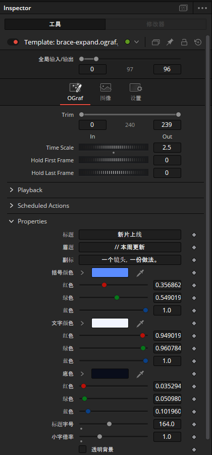 | 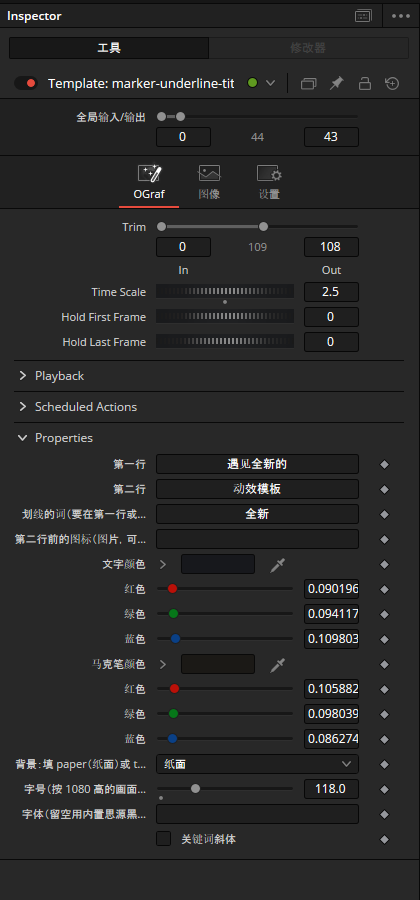 |

常见字段：

| 字段 | 用途 |
|---|---|
| 标题、强调词、数字、小字 | 卡片正文；强调词自动换成强调色，英文强调词转斜体 |
| 文字颜色、强调色、纸面色／背景色、卡片色 | 按品牌或主题改配色 |
| 字体预设、字体、字号、小字倍率 | 换字体风格；小字倍率统一缩放眉题、副标这类辅助信息 |
| 透明背景 | 去掉底色，叠加在实拍素材上（107 张有这个开关） |
| 卡片、眉题、数据组、脚注 | 图表与结构化卡片的内容，一行一项 |

每张卡的字段不完全相同，[图鉴](CATALOG.md)里标了每张卡的字段数，具体以检查器显示为准。

### 换图片

58 张卡有图片或标志字段，图鉴里标着「可换图」。这类字段在检查器里是一个文本框：在资源管理器里选中图片，按 `Ctrl+Shift+C` 复制路径，粘贴进去。多图字段一行一张，从上到下就是出场顺序。留空时卡片画占位块，动作照常。

本页和图鉴里的预览，图片位置填的是这套库自己的卡面截图。

### 换字体

- **字体预设**（97 张卡有）：内置、微软雅黑、宋体、楷体、仿宋、黑体、等线、思源宋体。「内置」用随包字体，其余用系统里装的同名字体；前六个是 Windows 自带的，思源宋体要自己装。
- **字体**：填任意已安装的字体名，填了就以它为准。
- **字体没装**：把字体文件放进这张卡的 `fonts` 文件夹，填 `fonts/文件名.ttf`。直接填 `C:\Windows\Fonts\...` 这种系统路径在达芬奇里不生效。

## 动起来看看

这些动图由模板包离屏渲染。前景和转场类的卡不带背景，动图里垫了一张自绘的演示底，实际使用时叠在你的素材上。

<table>
<tr>
<td align="center" width="50%"><br><b>纸面压印标题</b> <code>paper-title-card</code></td>
<td align="center" width="50%"><br><b>马克笔下划线标题</b> <code>marker-underline-title</code></td>
</tr>
<tr>
<td align="center" width="50%">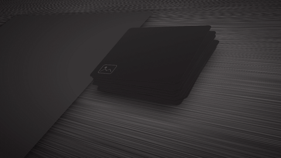<br><b>牌堆发卡满板</b> <code>deck-deal-flyin</code></td>
<td align="center" width="50%">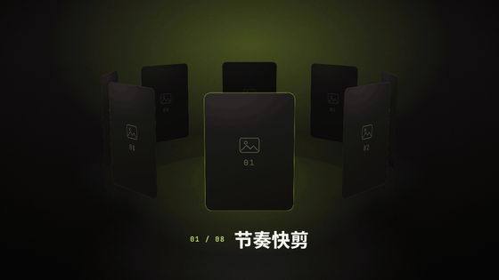<br><b>3D 环形画廊</b> <code>carousel-3d</code></td>
</tr>
<tr>
<td align="center" width="50%"><br><b>点阵聚成数字</b> <code>chart-live-moves-dot-swarm</code></td>
<td align="center" width="50%"><br><b>光斑飞线接力</b> <code>glow-flyline-moves-orb-flyline-relay</code></td>
</tr>
<tr>
<td align="center" width="50%">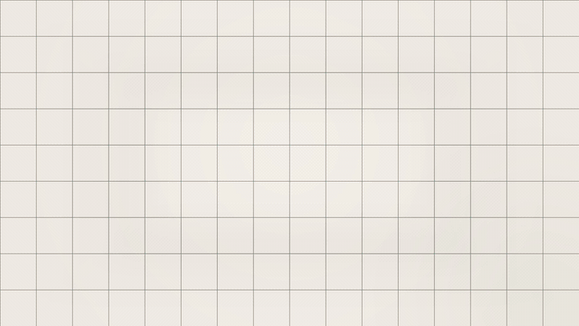<br><b>协作光标游走</b> <code>collab-cursor-moves</code></td>
<td align="center" width="50%">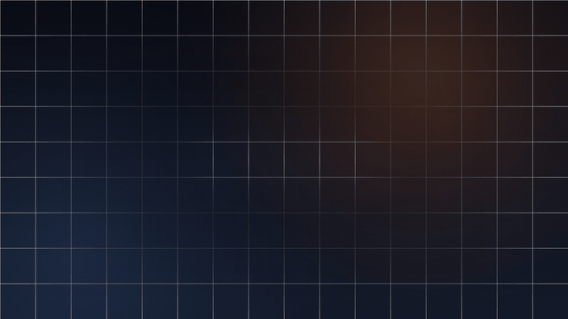<br><b>取景框咬合</b> <code>fui-hud-moves</code></td>
</tr>
<tr>
<td align="center" width="50%"><br><b>墨渗揭示转场</b> <code>print-texture-transitions</code></td>
<td align="center" width="50%"><br><b>字腔穿越转场</b> <code>transition-travel</code></td>
</tr>
</table>

这十张加上 `brace-expand` 和 `list-reveal` 就是入门包的内容。

## 分类浏览

按用途分七类。每类一张缩略图拼图，逐张的中文名、说明和字段数在[图鉴](CATALOG.md)里。

### 标题与版式 · 11 张

开场标题、套印字标、文字里嵌画面、标题降级成标签这类版式卡。[看这 11 张的说明](CATALOG.md#titles)


### 文字动效 · 22 张

逐词浮现、打字机、装配、压入、卡拉 OK 填色，文字本身的入场与节奏。[看这 22 张的说明](CATALOG.md#type-moves)


### 数据与图表 · 14 张

仪表、折线、点阵数字、时间线和信息图。[看这 14 张的说明](CATALOG.md#data)

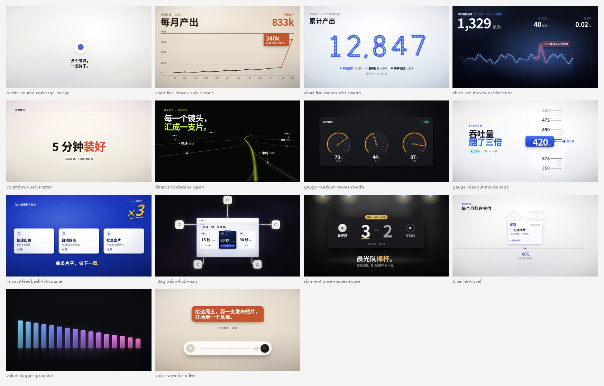

### 列表与步骤 · 4 张

菜单、步骤条、表格行这类条理内容的入场。[看这 4 张的说明](CATALOG.md#lists)

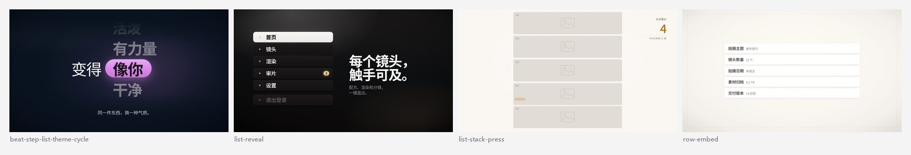

### 界面与交互 · 24 张

光标、HUD、扫描标注、下拉、药丸、滑块，界面演示与叠加标注。[看这 24 张的说明](CATALOG.md#ui)


### 卡片与场景 · 28 张

轮播、发牌、照片墙、俯拍桌面和 3D 场景这类画面主体卡。[看这 28 张的说明](CATALOG.md#cards-scenes)

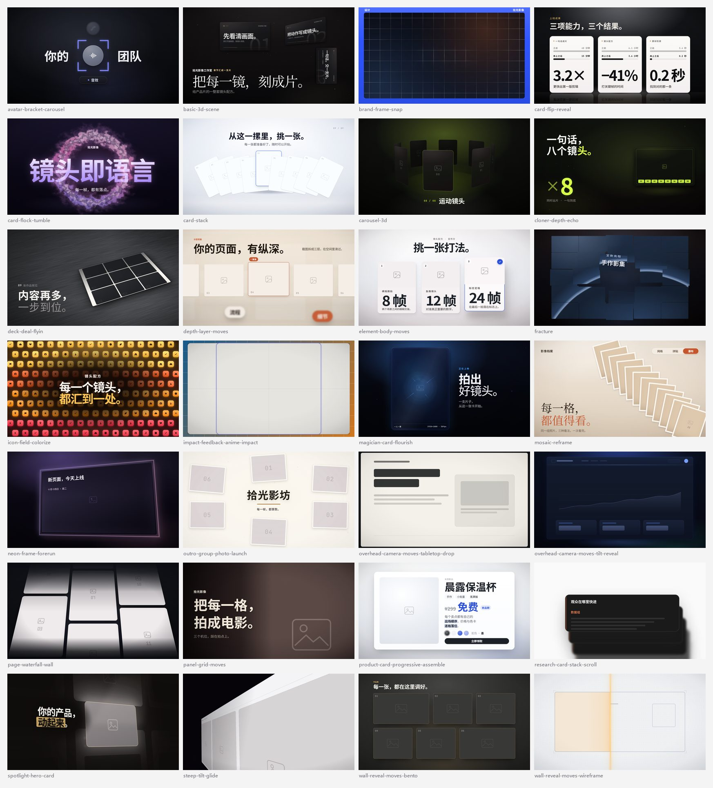

### 转场与光效 · 15 张

光轨、聚光、故障、溶解、印刷和空间转场。[看这 15 张的说明](CATALOG.md#transitions)


缩略图有两个来源：68 张是达芬奇 21.1.1 里的取帧；另外 50 张是用模板包离屏重渲的，其中带图片位的卡填了示例图，不带背景的叠加层卡垫了演示底。

## 验收与兼容

- **自动验收。** 2026-11-17 对 117 张卡逐张跑了 11 项机器检查，0 失败：同一时间点重复渲染逐帧一致、入场确实在动、片段前后隐藏、结束后隐藏、默认文案不出框、用的是随包字体、无报错、无 NaN、透明背景四角透明、1080×1920 竖屏不出框、超长文案变体。此后有两处改动（一张卡重做动效、字体预设由滑杆改成下拉），重新构建后抽查通过。手写的 `marker-underline-title` 不在这 117 张里，单独测过。
- **清单校验。** 118 份 `.ograf.json` 全部通过 OGraf 官方 JSON Schema 校验。
- **达芬奇里。** 21.1.1 上全部卡片导入成功并逐张取帧；21.1.2 上抽查通过。

| 环境 | 状态 |
|---|---|
| DaVinci Resolve Studio 21.1.1，Windows | 全库导入通过；下拉字段在这个版本里显示成文本框，手打选项名（比如「楷体」）即可 |
| DaVinci Resolve Studio 21.1.2，Windows | 抽查通过；下拉字段是真下拉 |
| 更高的 21.x | 没有逐一验证 |
| macOS、Linux | 没测过，见下方已知限制 |
| 免费版达芬奇 | 没测过 |
| DaVinci Resolve 20 及更早 | 不支持 OGraf |

## 常见问题

| 问题 | 怎么办 |
|---|---|
| 找不到检查器 | 点达芬奇窗口右上角的「检查器」按钮切换显示；先选中时间线上的卡，右侧默认就有 |
| 导入后画面上没东西 | 确认卡在时间线轨道上、播放头停在片段范围内；先选中片段，再拖播放头看效果 |
| 字体和预览不一样 | `fonts` 文件夹要和 `.ograf.json` 放在同一个目录；字体预设选「内置」就用随包字体 |
| .7z 打不开 | Windows 11（23H2 起）自带支持；其他系统装 [7-Zip](https://www.7-zip.org)，或者先下入门包的 .zip |
| 想直接克隆仓库 | 可以：`git clone` 只下载约 40 MB，检出后整个仓库占 690 MB；GitHub 的 Download ZIP 要下约 570 MB，因为 ZIP 不会去重 |

## 已知限制

- **只在 Windows 上测过。** 达芬奇的 OGraf 支持不限于 Windows，但字体预设里六个是 Windows 自带字体，别的系统上选了没有对应字体，会回到随包字体；想换字体就在「字体」框里填本机装了的字体名。
- **字段名和说明是中文。** 检查器里的标签、提示、默认文案都是中文。
- **图片字段没有「选文件」按钮**，要粘贴路径，见[换图片](#换图片)。
- **用脚本追加片段会崩。** 21.1.1 上用脚本的 `AppendToTimeline` 往时间线加 OGraf 片段会让达芬奇直接退出；手动拖拽不受影响，脚本建时间线用 `CreateTimelineFromClips` 没问题。

## 目录结构

```
templates/<分类>/<模板名>/
  <模板名>.ograf.json   导入达芬奇的清单文件
  graphic.mjs           图形本体
  fonts/                字体切片和字体许可证
  NOTICE.md             来源、改了什么、打包进来的第三方内容
  LICENSE-*.txt         上游许可证全文
CATALOG.md              118 张卡的图鉴
previews/               本页和图鉴用的图
```

分类目录是 `titles`、`type-moves`、`data`、`lists`、`ui`、`cards-scenes`、`transitions`。

## 来源与许可

**本仓库以 [Apache License 2.0](LICENSE) 发布。**

- 全部卡片改编自 [video-shotcraft](https://github.com/Vincentwei1021/video-shotcraft)（Vincentwei1021，Apache-2.0）的镜头卡，从 Remotion 合成改写为 OGraf v1 图形，对齐的上游版本是 `1266a3e`（2026-10-30）。每张卡的 `NOTICE.md` 写明了对应的上游文件和改动，并附上游许可证全文
- 字体为 Noto Serif SC、Noto Sans SC、JetBrains Mono，SIL Open Font License 1.1，许可证在各卡的 `fonts` 目录
- 打包进图形的运行时是 React、React DOM、scheduler，MIT License
- `marker-underline-title` 的时间调度写法参考了 Novaire 的 [sticker-graphics-free](https://github.com/NovaireGroup/sticker-graphics-free)（MIT License），许可证随卡
- OGraf 是 EBU 维护的开放图形规范，见 https://ograf.ebu.io

本仓库只放模板成品。把镜头卡改写成 OGraf 的生成器（构建脚本和兼容层）没有放进来。
