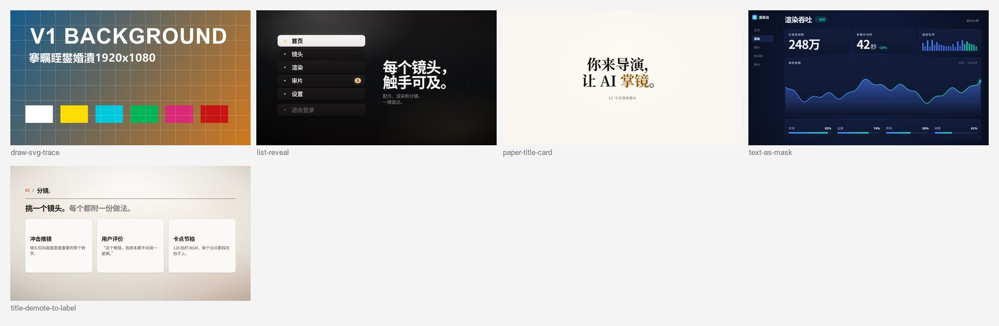
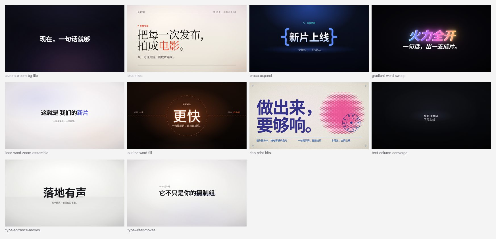
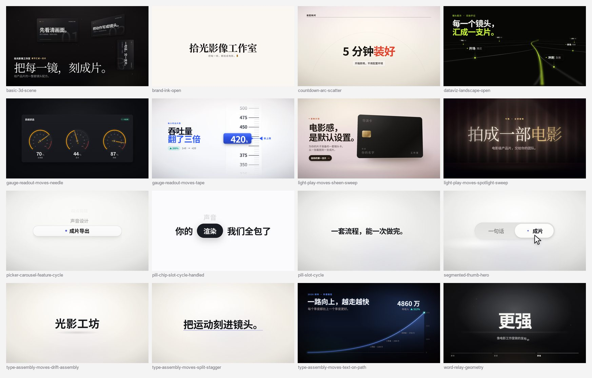
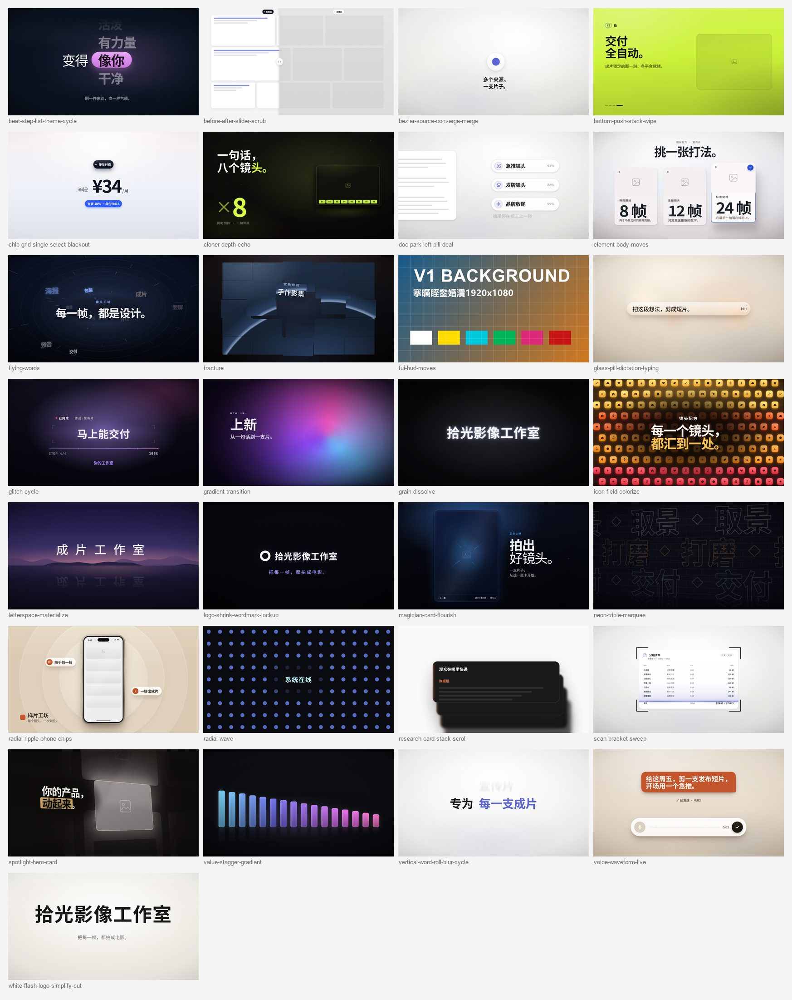
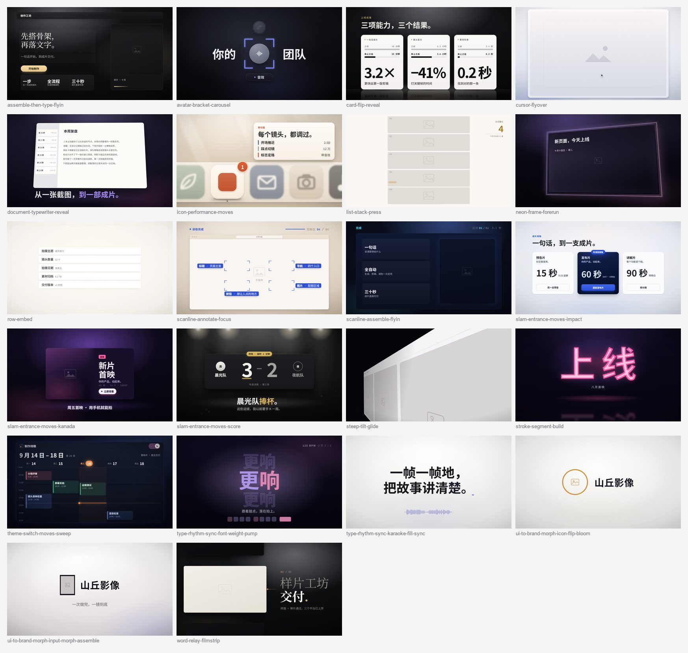
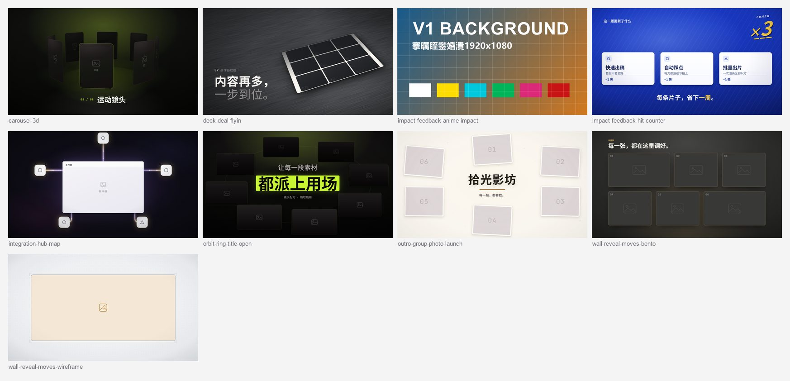
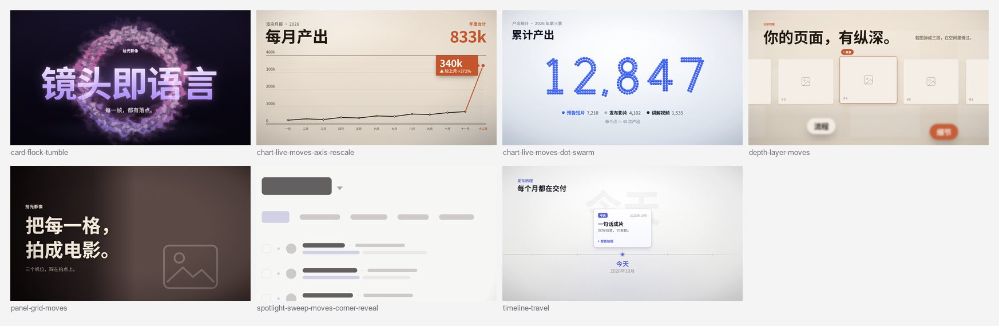
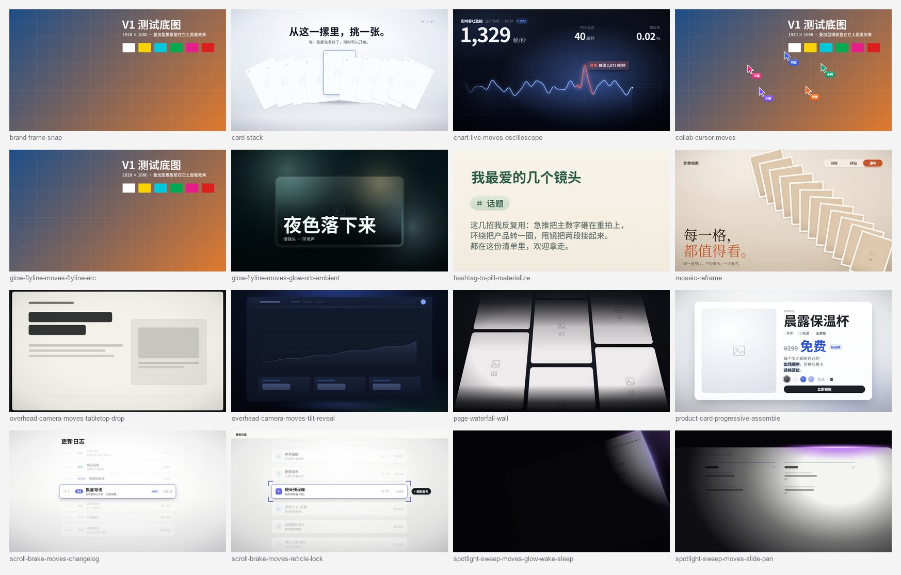
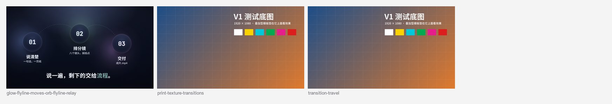

# DaVinci Resolve OGraf 模板库

> 117 张动态图文卡，导入达芬奇就能改字、改色、改字体。

这套卡是给 DaVinci Resolve 21 做的 [OGraf](https://ograf.ebu.io) 图形：标题、数据、列表、图表、转场都有，媒体池导入即用，不用装插件，也不用另外找字体。全部改编自开源项目 video-shotcraft 的镜头卡，在 21.1.1 和 21.1.2 上逐张验收过。


| | |
|---|---|
| 软件 | DaVinci Resolve 21（21.1.1、21.1.2 实测） |
| 图形格式 | OGraf v1 |
| 内容 | 117 张卡，加 marker 测试卡两个版本 |
| 许可 | Apache License 2.0，内置字体为 SIL OFL 1.1 |

## 这套卡的特点

- **字段全在检查器里。** 标题、强调词、数字、小字、配色、字号、字体预设都能改，动画节奏跟着参数走，不用进 Fusion 节点。
- **字体随包。** 每张卡自带 Noto 宋体／黑体的字体切片，目标机器不装字体也不跑版；字体预设还能切到楷体等风格。
- **片段长度随意。** 动效只取决于播放头位置，入场和出场按片段首尾对齐，剪多长都成立。
- **按批次整理。** 117 张卡分在 batch1–batch9，另有 marker 测试卡两个版本；每批都留了验收静帧与制作记录。

## 快速开始

1. 打开达芬奇，进入「媒体」页
2. 在媒体池空白处右键，选择「导入媒体」，选中某张卡目录里的 `<模板名>.ograf.json`
3. 把导入的图形拖到时间线上并选中
4. 在检查器里改文案、颜色、字号和字体预设，拖动播放头预览

同一个图形可以多次拖到时间线，每个实例的字段各自独立。

## 检查器里能改什么

| 字段 | 用途 |
|---|---|
| 标题、强调词、数字、小字 | 卡片正文；强调词自动换成强调色，英文强调词转斜体 |
| 文字颜色、强调色、纸面色／背景色、卡片色 | 按品牌或主题改配色 |
| 字体预设、字体、字号、小字倍率 | 一键换字体风格；小字倍率统一缩放辅助信息 |
| 透明背景 | 去掉底色，叠加在实拍素材上 |
| 卡片、叙事标题、眉题、数据组、脚注 | 图表与结构化卡片的内容字段 |

每张卡的字段不完全相同，以检查器实际显示为准。

## 卡片一览

按制作批次分组，每批配一张验收静帧拼图，点开列表可以看完整模板名。

### 第一批 · 5 张

纸面压印标题、马克笔下划线、文字遮罩、描边画出和列表逐条展开，整套卡从这里开始。



<details>
<summary>第一批的 5 张卡</summary>

- draw-svg-trace
- list-reveal
- paper-title-card
- text-as-mask
- title-demote-to-label

</details>

### 第二批 · 10 张

文字入场的一组：打字机、词级位移、渐变扫字、镂空填色、括号展开和糊化滑动。



<details>
<summary>第二批的 10 张卡</summary>

- aurora-bloom-bg-flip
- blur-slide
- brace-expand
- gradient-word-sweep
- lead-word-zoom-assemble
- outline-word-fill
- riso-print-hits
- text-column-converge
- type-entrance-moves
- typewriter-moves

</details>

### 第三批 · 16 张

信息呈现的一组：3D 场景底、仪表读数、数据图展开、倒计时弧、卡片轮播和文字装配。



<details>
<summary>第三批的 16 张卡</summary>

- basic-3d-scene
- brand-ink-open
- countdown-arc-scatter
- dataviz-landscape-open
- gauge-readout-moves-needle
- gauge-readout-moves-tape
- light-play-moves-sheen-sweep
- light-play-moves-spotlight-sweep
- picker-carousel-feature-cycle
- pill-chip-slot-cycle-handled
- pill-slot-cycle
- segmented-thumb-hero
- type-assembly-moves-drift-assembly
- type-assembly-moves-split-stagger
- type-assembly-moves-text-on-path
- word-relay-geometry

</details>

### 第四批 · 29 张

信息图与屏幕叙事：卡片堆叠滚动、扫描框标注、HUD、故障循环、光斑、声波和图标场，是数量最多的一批。



<details>
<summary>第四批的 29 张卡</summary>

- beat-step-list-theme-cycle
- before-after-slider-scrub
- bezier-source-converge-merge
- bottom-push-stack-wipe
- chip-grid-single-select-blackout
- cloner-depth-echo
- doc-park-left-pill-deal
- element-body-moves
- flying-words
- fracture
- fui-hud-moves
- glass-pill-dictation-typing
- glitch-cycle
- gradient-transition
- grain-dissolve
- icon-field-colorize
- letterspace-materialize
- logo-shrink-wordmark-lockup
- magician-card-flourish
- neon-triple-marquee
- radial-ripple-phone-chips
- radial-wave
- research-card-stack-scroll
- scan-bracket-sweep
- spotlight-hero-card
- value-stagger-gradient
- vertical-word-roll-blur-cycle
- voice-waveform-live
- white-flash-logo-simplify-cut

</details>

### 第五批 · 22 张

界面演示的一组：光标飞行、文档打字、扫描线标注、压入式入场、卡拉 OK 填色和品牌形变。



<details>
<summary>第五批的 22 张卡</summary>

- assemble-then-type-flyin
- avatar-bracket-carousel
- card-flip-reveal
- cursor-flyover
- document-typewriter-reveal
- icon-performance-moves
- list-stack-press
- neon-frame-forerun
- row-embed
- scanline-annotate-focus
- scanline-assemble-flyin
- slam-entrance-moves-impact
- slam-entrance-moves-kanada
- slam-entrance-moves-score
- steep-tilt-glide
- stroke-segment-build
- theme-switch-moves-sweep
- type-rhythm-sync-font-weight-pump
- type-rhythm-sync-karaoke-fill-sync
- ui-to-brand-morph-icon-flip-bloom
- ui-to-brand-morph-input-morph-assemble
- word-relay-filmstrip

</details>

### 第六批 · 9 张

场景与收尾：3D 轮播、牌组发牌、轨道标题、墙面揭开、命中反馈和合影收尾。



<details>
<summary>第六批的 9 张卡</summary>

- carousel-3d
- deck-deal-flyin
- impact-feedback-anime-impact
- impact-feedback-hit-counter
- integration-hub-map
- orbit-ring-title-open
- outro-group-photo-launch
- wall-reveal-moves-bento
- wall-reveal-moves-wireframe

</details>

### 第七批 · 7 张

图表与空间：三组实时图表、深度分层、面板网格、聚光扫过和时间线穿行。



<details>
<summary>第七批的 7 张卡</summary>

- card-flock-tumble
- chart-live-moves-axis-rescale
- chart-live-moves-dot-swarm
- depth-layer-moves
- panel-grid-moves
- spotlight-sweep-moves-corner-reveal
- timeline-travel

</details>

### 第八批 · 16 张

品牌与协作：品牌画框、协作光标、拼贴重构图、瀑布墙、商品卡装配、滚动刹车和光带扫过。



<details>
<summary>第八批的 16 张卡</summary>

- brand-frame-snap
- card-stack
- chart-live-moves-oscilloscope
- collab-cursor-moves
- glow-flyline-moves-flyline-arc
- glow-flyline-moves-glow-orb-ambient
- hashtag-to-pill-materialize
- mosaic-reframe
- overhead-camera-moves-tabletop-drop
- overhead-camera-moves-tilt-reveal
- page-waterfall-wall
- product-card-progressive-assemble
- scroll-brake-moves-changelog
- scroll-brake-moves-reticle-lock
- spotlight-sweep-moves-glow-wake-sleep
- spotlight-sweep-moves-slide-pan

</details>

### 第九批 · 3 张

转场与光效：光轨接力、印刷质感转场和空间转场。



<details>
<summary>第九批的 3 张卡</summary>

- glow-flyline-moves-orb-flyline-relay
- print-texture-transitions
- transition-travel

</details>

转场和前景层的卡（transition-travel、print-texture-transitions、collab-cursor-moves 等）在验收渲染里叠的是测试底图，画面带 V1 标记属于预期，实际使用时叠在自己的素材上。

## marker 测试卡

marker-underline-title 是这套卡的第一张，用来验证字段和渲染链路。v0.2 加入「背景」下拉字段，是整库唯一使用 select 字段的卡。


| 版本 | 目录 | 预览 |
|---|---|---|
| v0.1 | `templates/marker-underline-title/` | [视频](previews/marker-underline-title-preview.mp4) |
| v0.2 | `templates/marker-underline-title-v0.2/` | [视频](previews/marker-underline-title-v0.2-preview.mp4) |

与原镜头卡的对比：[marker-underline-title-vs-original.png](previews/marker-underline-title-vs-original.png)

## 兼容性

| 项目 | 状态 |
|---|---|
| DaVinci Resolve 21.1.1 | 全库实测通过；select 字段显示为文本框 |
| DaVinci Resolve 21.1.2 | 全库实测通过；select 字段变为下拉 |
| 更高的 21.x 版本 | 未逐一验证 |
| 竖屏工程 | 抽查通过，卡面不出框 |

## 目录结构

```
templates/
  batch1 … batch9/             117 张卡，每张一个目录
  marker-underline-title/      测试卡 v0.1
  marker-underline-title-v0.2/ 测试卡 v0.2
docs/                          18 份制作说明、验收清单与修改记录
previews/                      拼贴图、批次预览、marker 动图与视频
```

每张卡的目录里至少有 `<模板名>.ograf.json`、`graphic.mjs`、`fonts/`、`NOTICE.md` 和上游许可证。

## 来源与许可

**本仓库以 [Apache License 2.0](LICENSE) 发布。**

- 全部卡片改编自 [video-shotcraft](https://github.com/Vincentwei1021/video-shotcraft)（Vincentwei1021，Apache-2.0）的镜头卡，从 Remotion 合成改写为 OGraf v1 图形；每张卡内保留 `NOTICE.md` 与上游许可证全文
- 字体为 Noto Serif SC、Noto Sans SC、JetBrains Mono，SIL Open Font License 1.1，许可证随字体目录
- 打包运行时依赖 React、React DOM、scheduler，MIT License
- OGraf 为 EBU 维护的开放图形规范，见 https://ograf.ebu.io

## 文档与验收记录

`docs/` 保留了这套卡从制作到验收的全过程，比较常看的有：

- [媒体夹索引](docs/媒体夹索引.md)：全部卡的内容与用法索引
- [修复记录](docs/修复记录-20261117.md)：全库字体预设与细节修复
- [验收清单（第三到九批）](docs/验收清单-第三到九批.md)
- [人眼验收（第三到九批）](docs/人眼验收-第三到九批.md)
- [自动验收（全库）](docs/自动验收-全库-20261117.md)
- [动效重做：research-card-stack-scroll](docs/动效重做-research-card-stack-scroll-20261118.md)
- 每批的达芬奇试用清单见 `docs/达芬奇试用清单-第X批.md`

## 范围说明

本仓库只包含模板成品。生成器工程（构建脚本与兼容层，可用于重新构建全部卡片）、验收渲染和参考素材体积较大，未纳入仓库，另行备份。
